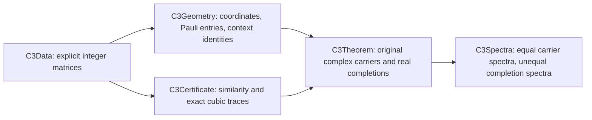

# Verification guide

The frozen C3 result is a concrete four-qubit example: two valid sign assignments have **equal carrier spectra and unequal completion spectra**. Lean checks the finite integer certificate, connects it to the original Pauli operators and signed contexts, and proves the spectral conclusion including multiplicities. The detailed [claim-to-theorem map](docs/CLAIMS.md) distinguishes that result from the earlier spectral bound, executable experiments, and the paper's additional algebraic consequences.

The numbers **42** and **6** count audited declarations: 42 for C3 and six for the auxiliary scalar stability result. Every reported dependency list uses only `propext`, `Classical.choice`, and `Quot.sound`.

## Frozen research and documentation versions

The mathematical record is [research release `v0.2.0-c3-certificate`](https://github.com/0thernes/hoggar-bound-lab/releases/tag/v0.2.0-c3-certificate), at commit [`d3811e3b53048fa8f3206f08494f0a9834eed287`](https://github.com/0thernes/hoggar-bound-lab/tree/d3811e3b53048fa8f3206f08494f0a9834eed287). It was published on 10 November 2026 at 01:33:37 UTC. This guide is prepared for the planned documentation release `v1.1.1`, with the same proof sources. The research release, PDF, and historical verification records retain their original version identifiers.

The [source manifest](results/frontier-c3-lean-source-sha256.json) records 21 proof/configuration files, exact local hashes, and hashes after normalizing CRLF to LF. All 21 LF hashes match this documentation checkout and the frozen research sources. The [published Linux source-equivalence record](https://github.com/0thernes/hoggar-bound-lab/releases/download/v0.2.0-c3-certificate/linux-proof-source-equivalence.json) connects the successful Linux proof to the publication commit.

| Evidence | Exact checked commit | Observed result |
| --- | --- | --- |
| [Ubuntu run 42728421086](https://github.com/0thernes/hoggar-bound-lab/actions/runs/42728421086) | `85520dc263c83de55d1a3d107cd80e7068be8616` | Entire workflow succeeded. The downloaded logs contain all 42 C3 and six stability axiom reports. |
| [Main run 42732149645](https://github.com/0thernes/hoggar-bound-lab/actions/runs/42732149645) | `026961ef81f70aa7cc464b527d4ca30e647e6b17` | The executable job succeeded. Its redundant formal job was cancelled after the identical proof sources had passed in the independent run. The workflow conclusion is **cancelled**. |
| Frozen research publication | `d3811e3b53048fa8f3206f08494f0a9834eed287` | All 21 proof/configuration LF hashes match the successful Linux sources. The presentation follow-up changed the paper HTML, its builder, and its HTML build record. |

The full Ubuntu proof record is the successful `85520dc` run. The cancelled `026961ef` workflow is evidence for its completed executable job, and is never used as a whole-workflow proof pass. Current scholarly-submission status is recorded separately in [publication/STATUS.md](publication/STATUS.md).

The documentation release has a separate [continuity checker](scripts/publication_release_audit.py). From a documentation checkout that contains the frozen research commit, run:

```bash
python scripts/publication_release_audit.py --output build/verification/documentation-continuity.json
```

It compares the 21 proof/configuration files and the retained C3 code, data, paper, and license artifacts against `d3811e3`, checks the recorded 42-name audit and publication metadata, and reports any changed research artifact. Text comparisons normalize CRLF to LF; binary artifacts are compared byte for byte. A pass establishes continuity with the frozen research record. It is **not a new Lean compilation**. The checker belongs to the documentation update and is not present in the older research-tag checkout used below.

## What Lean proves

The section contains 71 real nonidentity Pauli points, and its complement in the real quadric contains 64 points. The polar point has code 128. With the code convention `v = a + 16c` and qubit zero the least significant bit, the assignments are positive except at:

| Assignment | Negative section labels |
| --- | --- |
| `signA` | 48, 102, 176, 230 |
| `signB` | 87, 144, 176, 215 |

The carriers are 16 × 16 Hermitian Pauli sums. The completions are 64 × 64 real signed-context operators. Their completion cubic traces are exactly **14976** and **15360**, a difference of 384.

In namespace `HoggarBound.C3`, the main statements are:

- [`four_qubit_C3_counterexample`](lean/HoggarBound/C3Theorem.lean): valid section signs, equal actual carrier characteristic polynomials, and those two actual completion cubic traces.
- [`pauli_carrier_eigenvalues_eq`](lean/HoggarBound/C3Spectra.lean): equality of the carriers' canonical real eigenvalue functions.
- [`pauli_completion_eigenvalue_multisets_ne`](lean/HoggarBound/C3Spectra.lean): different real characteristic-polynomial root multisets for the completions.
- [`four_qubit_C3_spectral_counterexample`](lean/HoggarBound/C3Spectra.lean): the combined carrier-characteristic-polynomial equality and completion-characteristic-polynomial/root-multiset inequalities.

This refutes the strict law that a carrier spectrum determines the completion spectrum in this four-qubit C3 case. It establishes the corresponding instance of Conjecture E, which predicts failure of that law. The paper and [claim map](docs/CLAIMS.md) explain the precise scope.

## How the finite data reaches the Pauli model



The supplied matrices and intermediate squares are concrete input data. Lean verifies their relationships:

1. [`C3Geometry.lean`](lean/HoggarBound/C3Geometry.lean) proves the coordinate bijection and binary addition rule, identifies the real polar section, checks the 71/64 cardinalities, and proves that every outside point occurs exactly once.
2. `realPauliCode_cast` equates the integral entry formula with the original complex [`pauli`](lean/HoggarBound/Pauli.lean) definition. The carrier and completion data are checked against the signed Pauli sums and the commuting-context definition. The integer context sign is connected to the original real `lineSign` by [`lineSign_eq_integer`](lean/HoggarBound/IndependentWitness.lean).
3. [`C3Certificate.lean`](lean/HoggarBound/C3Certificate.lean) checks `A M = M B` and `M R = 46656 I`, derives `det M ≠ 0`, and obtains exact carrier characteristic-polynomial equality. It verifies each supplied intermediate completion square, then verifies the cubic traces. The square checks are divided into rows to control memory.
4. [`C3Theorem.lean`](lean/HoggarBound/C3Theorem.lean) proves the required coefficient casts and basis reindexing into the original Pauli model. [`C3Spectra.lean`](lean/HoggarBound/C3Spectra.lean) proves Hermitian symmetry and applies the spectral theorem to obtain different completion eigenvalue multisets.

The closed integer equalities use `decide +kernel`. The source and axiom audits found no `sorry`, `admit`, custom axiom, `native_decide`, or `ofReduceBool` in the C3/stability development. The [42-declaration entry point](lean/C3Verification.lean), [raw axiom output](results/frontier-c3-lean-axioms.log), and [parsed report](results/frontier-c3-axioms.json) expose the exact audited scope. The trusted setup remains Lean's kernel and the pinned dependencies; this is not a proof of compiler or hardware correctness.

## Inspect the recorded evidence

The frozen release retains durable copies of the CI evidence, in addition to the GitHub Actions run pages:

- [Linux proof audit](https://github.com/0thernes/hoggar-bound-lab/releases/download/v0.2.0-c3-certificate/linux-verification-audit.json), [raw Lean job log](https://github.com/0thernes/hoggar-bound-lab/releases/download/v0.2.0-c3-certificate/linux-lean-job.log), and [original Lean evidence ZIP](https://github.com/0thernes/hoggar-bound-lab/releases/download/v0.2.0-c3-certificate/linux-lean-evidence.zip).
- [Linux executable audit](https://github.com/0thernes/hoggar-bound-lab/releases/download/v0.2.0-c3-certificate/linux-executable-audit.json) and [executable evidence ZIP](https://github.com/0thernes/hoggar-bound-lab/releases/download/v0.2.0-c3-certificate/linux-executable-evidence.zip), including the cancelled workflow's accurate job-level status.
- [Windows formal audit](results/frontier-c3-lean-audit.md), [certificate process record](results/frontier-c3-lean-certificate-process.json), [theorem log](results/frontier-c3-lean-theorem.log), and [spectral-wrapper log](results/frontier-c3-lean-spectra.log).
- [Release checksums](https://github.com/0thernes/hoggar-bound-lab/releases/download/v0.2.0-c3-certificate/SHA256SUMS.txt) and [release manifest](https://github.com/0thernes/hoggar-bound-lab/releases/download/v0.2.0-c3-certificate/release-manifest.json).

The original Linux Lean ZIP has SHA-256 `20a738c732521050086db8f49cdf64a1a9143a63dff23de4626502a20e797501`. Its raw C3 and stability logs were independently parsed, rather than relying only on a workflow badge or a checklist. Archived logs document an earlier successful execution; a fresh rebuild supplies a new check on the reader's machine.

## Rebuild the frozen proof

Prerequisites are Git, an Elan/Lake installation, and network access for the pinned dependencies. The examples below use Bash. The Lean commands themselves also ran successfully on Windows. Use a fresh checkout of the research tag:

```bash
git clone --branch v0.2.0-c3-certificate --depth 1 https://github.com/0thernes/hoggar-bound-lab.git hoggar-bound-lab-verification
cd hoggar-bound-lab-verification
git rev-parse HEAD
# Expected: d3811e3b53048fa8f3206f08494f0a9834eed287
cd lean
lake env lean --version
```

The committed [`lean-toolchain`](lean/lean-toolchain) selects **Lean 4.35.0**. [`lakefile.toml`](lean/lakefile.toml) and [`lake-manifest.json`](lean/lake-manifest.json) pin **Mathlib v4.35.0**, revision `56a005855ea17e0b0958f73ec801ae140b0a1679`. The recorded Lean compiler commit is `eb6cafb7290e8bd5f2937522d8d804f58f02bafc`.

Fetch the pinned Mathlib cache and build the project modules in separate, sequential commands. This follows the [CI workflow](.github/workflows/independent-verification.yml):

```bash
set -euo pipefail
export LEAN_NUM_THREADS=1
lake exe cache get Mathlib.Analysis.Matrix.Spectrum Mathlib.Algebra.Order.Chebyshev Mathlib.Data.ZMod.Basic Mathlib.Tactic Mathlib.LinearAlgebra.Matrix.Charpoly.Basic
lake build HoggarBound
lake build HoggarBound.IndependentContexts
lake build HoggarBound.IndependentWitness
lake env lean IndependentVerification.lean
lake build HoggarBound.C3Data
lake build HoggarBound.C3Certificate
lake build HoggarBound.C3Geometry
lake build HoggarBound.C3Theorem
lake build HoggarBound.C3Spectra
lake build HoggarBound.Stability
mkdir -p ../build/verification
lake env lean C3Verification.lean 2>&1 | tee ../build/verification/c3-axioms.log
lake env lean StabilityVerification.lean 2>&1 | tee ../build/verification/stability-axioms.log
```

The default root library contains the earlier development. The explicit C3 targets above ensure that the new certificate and its connection to the Pauli model are rebuilt. The Mathlib cache supplies pinned dependencies; the repository's project modules are compiled from source in a fresh checkout.

From the repository root, enforce the declaration counts and permitted axiom set. These commands require Python and write their reports into `build/verification/`:

```bash
cd ..
python scripts/frontier_c3_axioms.py build/verification/c3-axioms.log --minimum 42 --output build/verification/c3-axioms.json
python scripts/frontier_c3_axioms.py build/verification/stability-axioms.log --source lean/StabilityVerification.lean --minimum 6 --output build/verification/stability-axioms.json
```

Both commands must report `PASS`, with counts 42 and 6. The parser checks that every declaration requested in the corresponding source entry point is present and that no axiom outside the three permitted names occurs. The separate [earlier verification entry point](lean/IndependentVerification.lean) audits 22 declarations for the general bounds, context correspondence, and exact three-qubit witness.

## Expected proof costs

These are measured runs, not portable runtime guarantees. The finite certificate is the dominant computation; a build can legitimately spend many minutes inside that module without printing a stage message. Allow at least 16 GB memory and run the substantial builds sequentially.

| Check | Measured time | Memory evidence |
| --- | --- | --- |
| Windows C3 certificate | 60.9 minutes wall; 3523.703 CPU seconds | Peak working-set counter 7,741,747,200 bytes; peak paged-memory counter observed 12,402,831,360 bytes. These counters measure different things. |
| Windows C3 geometry | 212 seconds reported by Lake | See the [geometry log](results/frontier-c3-lean-geometry.log). |
| Ubuntu C3 certificate | 50:19.33 wall | Maximum RSS 11,522,464 KiB; exit status 0. |
| Ubuntu C3 geometry | 2:40.62 wall | Maximum RSS 4,957,980 KiB; exit status 0. |

The Ubuntu numbers are in `independent-ci-lean-c3-certificate.log` and `independent-ci-lean-c3-geometry.log` inside the published [Lean ZIP](https://github.com/0thernes/hoggar-bound-lab/releases/download/v0.2.0-c3-certificate/linux-lean-evidence.zip). Dependency retrieval, earlier modules, and the short final wrappers add time. The local scalar stability build reported 12 seconds. The CI proof job allows 180 minutes and records resources; its temporary-runner swap setup is documented in the workflow, not a requirement to alter a reader's machine.

## Faster executable and falsification checks

The independent arithmetic checks and browser test can be run before a full Lean rebuild. CI used Python 3.12, NumPy 2.0.2, SymPy 1.14.0, and Node 24. From the repository root:

```bash
python -m pip install numpy==2.0.2 sympy==1.14.0
python scripts/frontier_c3_verify.py
python scripts/frontier_c3_context_verify.py
python scripts/frontier_c3_similarity.py
python scripts/frontier_c3_integer_bounds.py
python scripts/frontier_c3_certificate_audit.py
node tests/frontier_c3_browser_test.cjs
```

The checks independently reconstruct literal Pauli tensors and 1120 signed outside contexts, compare the supplied data with the Lean matrix definitions, verify exact integer identities, and exercise deliberately changed signs and invalid inputs. Their outputs are recorded in the [context report](results/frontier-c3-context-verification.json), [data audit](results/frontier-c3-certificate-audit.json), and [published executable evidence](https://github.com/0thernes/hoggar-bound-lab/releases/download/v0.2.0-c3-certificate/linux-executable-evidence.zip). They provide independently testable evidence; the fixed Lean statements are established by the proof rebuild above. Interactive perturbations do not automatically acquire a new Lean certificate.

## Boundaries and prior work

The scalar cubic inequality and Pauli spectral floor are documented prior work; the earlier modules are formalization and reproduction results. The full three-qubit minimum 63 is also a prior result. See the [literature audit](results/literature-audit.md) for the comparisons and qualifications.

The C3 audit proves this explicit four-qubit spectral failure. The paper's displayed polynomial factorization, block/Jordan formulas, largest-eigenvalue gap of **2**, and continuous-relaxation gap of **32** have separate algebraic or executable evidence. They are outside the 42-declaration Lean boundary. The auxiliary stability theorem is about scalar spectra; its matrix and Pauli-coordinate interpretations remain ordinary mathematical derivations. The [claim map](docs/CLAIMS.md) states those distinctions individually.
