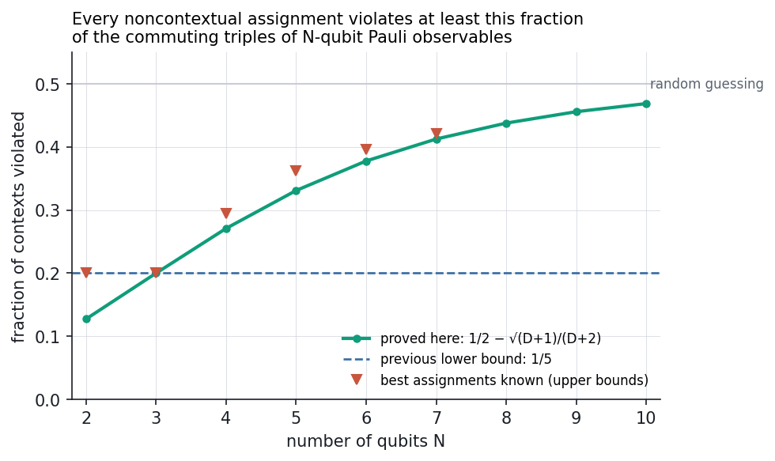
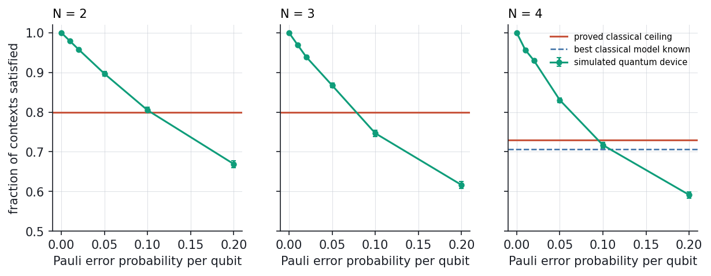
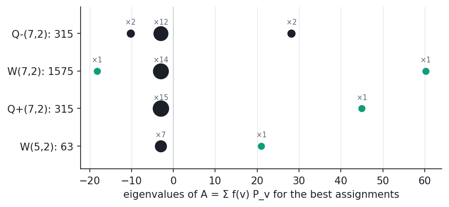

# A machine-checked spectral floor for Pauli contextuality, and new configurations that attain it

**Lean 4 formalization for every number of qubits; exact contextuality degrees of four-, five- and seven-qubit configurations outside the classical families; a classification of flat third-level phase states; a running demonstration on the Tsotchke stack**

Alexander S. Donahue, 0thernes LLC, Washington, USA. ORCID: [0009-0006-8168-9648](https://orcid.org/0009-0006-8168-9648). Correspondence: 0_0@0thernes.art<br>
Hoggar Bound Lab, version 1.1, 9 November 2026. Research preprint. Not peer reviewed.<br>
Produced with an AI research system (Claude, Anthropic) under the author's direction; see Section 12.

> **Priority note.** The inequality formalized here was first posted by B. W. Jonah on 21 October 2026
> (Zenodo, [doi:10.5281/zenodo.23538829](https://doi.org/10.5281/zenodo.23538829)), where it is called the
> *spectral lower bound* or *spectral floor*. We derived it independently on 9 November 2026 and learned of the
> earlier notes the same day, during our own literature audit. Priority for the bound, for its saturation
> by Hoggar-type states in the three classical families, and for the exact four- and five-qubit values of
> those families belongs to the works cited in Section 1.2. What is new here is stated in Section 1.1; the
> results of Section 5 were found after that audit and were checked against the same sources.

## Abstract

A noncontextual hidden-variable model assigns a value $\pm 1$ to every $N$-qubit Pauli observable. The
*contextuality degree* of a set of observables is the least number of its contexts (commuting triples
with product $\pm I$) that such an assignment must get wrong. We give a kernel-checked Lean 4 proof, for
every $N$ and for arbitrary sets $S$, of the spectral floor first posted by B. W. Jonah:
the number of satisfied minus violated contexts is at most $`(D-2)\,|S|^{3/2} / (6\sqrt{D-1})`$, where
$D = 2^N$. The floor is attained exactly when a pure state has Pauli expectation values of one modulus
on $S$ and zero elsewhere. We exhibit such configurations outside the classical families and determine
their degrees exactly: 135 four-qubit observables with 1095 contexts (degree 75) and 496 five-qubit
observables with 10880 contexts (degree 480), both proved in Lean with kernel-evaluated counts, and 8128
seven-qubit observables with 2 824 192 contexts (degree 729 344). The Pauli support of any such state is
a two-character set, hence gives a strongly regular graph, and a bent function in the three-, five- and
seven-qubit cases. By exhaustive enumeration we classify the states $U|{+}\cdots{+}\rangle$, with $U$ a
diagonal gate of the third level of the Clifford hierarchy, that have this property on up to five
qubits: there is none on four qubits and one class on five, a circuit of three controlled-S and two
$CCZ$ gates whose configuration is Clifford-equivalent to the support of a state found numerically by
Cieśliński. On seven qubits a circuit of three controlled-S and eight $CCZ$ gates gives the configuration
above. For the classical families the checked corollaries include a violated fraction of at least
$1/2 - \sqrt{D+1}/(D+2)$ for the full $N$-qubit configuration, for every $N$. The work was produced with
an AI research system under the author's direction, as disclosed in the paper.

## 1. Scope

### 1.1 What is new in this work

1. **A formal proof of the floor.** The spectral floor is proved in Lean 4 for every number of qubits
   $N \ge 1$ and for *arbitrary* sets of observables with their induced contexts (theorem
   `hoggar_bound`). The proof is about the actual matrices: Pauli operators are defined as explicit
   complex matrices indexed by bit vectors, their product phases and commutation rule are theorems, and
   the bound is derived from the spectral theorem. Earlier accounts of the bound are explicitly not
   formally verified [J2], and the earlier Lean development of Li, Gupta and Ganesh [LGG] covers one
   four-qubit configuration by a different (combinatorial) argument.
2. **Exact degrees outside the classical families** (Section 5). The published statements of the floor
   and of its equality case concern families closed under products of commuting pairs: the full space
   and the quadrics [J2]. The trace argument needs no closure, and the floor is attained on sets that are
   not closed. We determine two such degrees exactly: 75 for a 135-point four-qubit configuration with
   1095 contexts, and 480 for a 496-point five-qubit configuration with 10880 contexts. Both are
   proved in Lean in full (theorems `pivot_degree` and `cieslinski5_degree`): the lower bound is an
   instance of `hoggar_bound`, the upper bound an explicit assignment, and the counts are kernel
   evaluations.
3. **A four-qubit state.** The state $\psi_B$ of the abstract has Pauli expectation values $\pm 1/3$ on
   135 observables and $0$ on the other 120, like the known state $(-3,1,\dots,1)/\sqrt{24}$, but its
   support is not a quadric. We classify all $4^6$ states with fourth-root-of-unity amplitudes on the
   same six basis states: they fall into exactly two classes, according to the parity of the number of
   imaginary amplitudes (Proposition 6).
4. **A saturation criterion for arbitrary sets** (Theorem 4), in spectral, state and purely combinatorial
   form; the observation that for every such state the violated contexts are the pairs of largest
   quantum metric (Proposition 8); and the fact that the support of such a state is a two-character
   set, so that it defines a strongly regular graph, and a bent function when the modulus is
   $2^{-(N-1)/2}$ (Proposition 10).
5. **Flat phase states** (Section 5.3). A state $U|{+}\cdots{+}\rangle$ with $U$ a product of $T$,
   controlled-S ($CS$) and $CCZ$ gates has a single non-zero modulus exactly when a symmetric trilinear form
   over $`\mathbb{F}_2`$ has constant rank (Proposition 11). We enumerate all such forms on up to five
   qubits (Theorem 12): none on four qubits, one class on five. The five-qubit class gives a
   five-gate circuit for a state with the Pauli support of [Ci]'s numerically found $s_5$, up to a
   Clifford operation.
6. **Seven qubits** (Theorem 13). A circuit of three $CS$ and eight $CCZ$ gates prepares a state
   with expectation values $\pm 1/8$ on 8128 observables and $0$ on the others. The configuration has
   2 824 192 contexts and contextuality degree exactly 729 344. Within the family of forms we could
   enumerate completely (about $1.5 \times 10^{10}$ forms) it is unique up to CNOT circuits.
7. **Formally verified numerical corollaries for the classical families**, listed in the abstract and in
   Table 2, including formal answers to two questions asked in [LGG]: the degree of $Q^+(9,2)$ exceeds
   $4743$, and the violated fraction of the four-qubit full space and of the five-qubit hyperbolic
   quadric is strictly above $1/5$. The exact values 63 (three qubits) and 315 (four-qubit hyperbolic
   quadric) are also proved in full, by the spectral route.
8. **Consequences spelled out for all $N$**: an exponentially growing quantum-to-classical ratio with
   a proof (the 2010 argument for such growth rests on a lemma that fails at three qubits), a noise
   threshold that tends to zero, and a two-sided estimate of the optimal violated fraction (Proposition 4).
9. **An independent reproduction and a running demonstration**: a search engine, four independent
   implementations of the geometry (C, Python, JavaScript, Eshkol) and the Lean model agree on every
   count; the experiments run on the Tsotchke stack with each component labelled for what it is. The
   five- and seven-qubit states are prepared there as circuits.

### 1.2 What is not new, and whose it is

* The contextuality degree and its first values: de Boutray, Holweck, Giorgetti, Masson and Saniga
  [dB]; Muller, Saniga, Giorgetti, de Boutray and Holweck [M1] (three-qubit degree 63, the split Cayley
  hexagon of violated contexts); Muller, Saniga, Giorgetti, Holweck and Kelleher [M2] (upper bounds
  for four to seven qubits, lower bound $L/5$); Saniga et al. [S] (hexagons).
* The exact value $315$ for the four-qubit hyperbolic quadric, its 240 optimal sets and a Lean proof of
  that value: Li, Gupta and Ganesh [LGG].
* The exact values $d(Q^-(7,2)) = 315$, $d(W(7,2)) = 1575$, $d(Q^+(9,2)) = 6975$ (computer-assisted),
  the operator $A = \sum_v f(v) P_v$ and its Hoggar spectrum $`\{21, -3^7\}`$: Jonah [J1].
* The spectral floor itself, its Kramers (quaternionic) form for elliptic quadrics, the description of
  quadrics by the antiunitaries $P_c K$, the operator identity for $A^2$ on sets closed under products,
  and the theorem that among the three families the floor is attained exactly for
  $W(5,2)$, $Q^+(7,2)$, $Q^-(5,2)$ (and trivially $`Q^-(3,2)`$): Jonah [J2], with the trace formula also
  in [J3]. Stronger five-qubit lower bounds ($d(W(9,2)) \ge 28830$, $d(Q^-(9,2)) \ge 6510$) are
  announced, with proofs held privately, in [J4]. Sets that are not closed under products are named in
  [J2] as not covered.
* Pure states whose Pauli expectation values are zero or of one modulus: the two-qubit state of Liu, Low
  and Yin [LLY]; the four-qubit state $(-3,1,\dots,1)/\sqrt{24}$ and the five-qubit state $|s_5\rangle$
  with 135 and 496 non-zero values, found numerically by Cieśliński [Ci], who calls a (possibly mixed)
  state *Pauli flat* when all of its Pauli expectation values have one modulus and lists these pure
  states under the relaxed condition; real four-qubit states of this kind as the optima of $Q^+(7,2)$
  [J4]. Kang [K] proves that no four-qubit state, and no state of an odd number $N \gt 1$ of qubits, has
  all squared Pauli expectation values in $`\{0, 2^{-N}\}`$. None of [LLY, Ci, K] discusses contextuality,
  phase states, or more than five qubits.
* Diagonal gates of the Clifford hierarchy and their phase polynomials: Cui, Gottesman and Krishna
  [CGK]. $`\mathbb{Z}_4`$-valued quadratic forms and their character sums: [CCKS]. Two-character sets,
  two-weight codes and strongly regular graphs: Calderbank and Kantor [CK]. The bent functions of
  Maiorana and McFarland: [McF].
* The scalar inequality behind the floor is classical: it is Okumura's lemma [O] (equivalently the
  maximal sample skewness, Wilkins [W]).
* The Hoggar lines and the cubic purity condition for quantum states: Hoggar [H], Stacey [St],
  Jones and Linden [JL]. Bent functions and their difference sets: Rothaus [R]. Point sets with the
  hyperplane intersection numbers of a quadric (quasi-quadrics): De Clerck, Hamilton, O'Keefe and
  Penttila [DHOP].

Our derivation in Sections 3, 4 and 6 was made without knowledge of [J1]–[J4]; where it coincides with
them we say so. We did not re-run the exhaustive computations behind the exact values of [J1] and do
not vouch for them; we only observe that every assignment we found is consistent with them. A companion
note in the same repository, written by a separate set of AI agent sessions, settles an instance of a
conjecture of [J3] that is unrelated to the results here; it is not part of this paper.

## 2. Setting

**Pauli operators.** Let $D = 2^N$. A *point* is a nonzero vector $`v = (a \mid c) \in \mathbb{F}_2^{2N}`$.
It labels the Hermitian operator

```math
P_v \;=\; i^{\,|a \wedge c|}\, X^{a} Z^{c},
```

a tensor product of $I, X, Y, Z$ (the exponent $|a \wedge c|$ counts the factors equal to $Y = iXZ$).
$P_0 = I$, $P_v^2 = I$, and $\operatorname{tr} P_v = 0$ for $v \ne 0$. Products close up to a phase,

```math
P_u P_v = \tau(u,v)\, P_{u+v}, \qquad
\tau(u,v) = i^{\,k_u + k_v + 3 k_{u+v}}\,(-1)^{c_u \cdot a_v}, \quad k_v = |a_v \wedge c_v| ,
```

and with the symplectic form $\langle u, v\rangle = c_u\cdot a_v + c_v \cdot a_u$ one has
$\tau(v,u) = (-1)^{\langle u,v\rangle}\tau(u,v)$ and $\tau(u,v)^2 = (-1)^{\langle u,v\rangle}$.
So $P_u$ and $P_v$ commute exactly when $\langle u,v\rangle = 0$, and then $`\tau(u,v) = s(u,v) \in \{+1,-1\}`$.

**Contexts.** A *context* (a line of the symplectic polar space $`W(2N-1,2)`$) is a set
$`\ell = \{u, v, u+v\}`$ of three distinct points with $\langle u, v\rangle = 0$. Its three operators commute and
$`P_u P_v P_{u+v} = s_\ell\, I`$ with $`s_\ell = s(u,v)`$, which does not depend on the order.

**Configurations and assignments.** Fix a set $S$ of points and let $\mathcal{L}(S)$ be the set of all
contexts contained in $S$, $L_S = |\mathcal{L}(S)|$. $S$ is *closed* if the product of any two commuting
observables of $S$ is again in $S$. An assignment $`f : S \to \{+1,-1\}`$ *violates*
$\ell$ when $`f(u) f(v) f(u+v) \neq s_\ell`$. Put

```math
\beta_S(f) = \sum_{\ell \in \mathcal{L}(S)} s_\ell\, f(u) f(v) f(u+v) = L_S - 2\,\mathrm{viol}(f),
\qquad d(S) = \min_f \mathrm{viol}(f).
```

$d(S)$ is the contextuality degree [dB]. For the noncontextuality inequality
$`\chi = \sum_\ell s_\ell \langle P_u P_v P_{u+v}\rangle \le L_S - 2 d(S)`$ quantum mechanics gives
$\chi = L_S$ in every state [C, LGG].

**Three families.** The *full space* is $`S = \mathbb{F}_2^{2N}\setminus\{0\}`$, with $D^2-1$ points
and $L = (D^2-1)(D^2-4)/12$ contexts. For $`c \in \mathbb{F}_2^{2N}`$ let $q_0(v) = |a\wedge c| \bmod 2$ and
$`Q_c = \{ v \ne 0 : q_0(v) + \langle c, v\rangle = 0\}`$. $Q_c$ is a *hyperbolic* quadric $Q^+(2N-1,2)$ if
$q_0(c) = 0$ and an *elliptic* quadric $Q^-(2N-1,2)$ if $q_0(c) = 1$. With $K$ complex conjugation in the
computational basis, $\theta_c = P_c K$ is antiunitary, $\theta_c P_v \theta_c^{-1} = (-1)^{q_0(v) + \langle c,v\rangle} P_v$
and $\theta_c^2 = (-1)^{q_0(c)}$. So the quadrics are the sets of Pauli observables fixed by a Pauli
antiunitary: a real structure ($\theta^2 = 1$) for hyperbolic quadrics and a quaternionic structure
($\theta^2 = -1$) for elliptic ones [J2]. $Q_0$ is the set of real symmetric Pauli matrices (an even
number of $Y$ factors). All three families are closed.

## 3. The spectral floor

**Theorem 1 (spectral floor; Jonah [J2] for the three families; formalized here for arbitrary $S$).**
Let $N \ge 1$, let $S$ be any set of points and $`f : S \to \{\pm 1\}`$. Then

```math
\beta_S(f) \;\le\; \frac{(D-2)\,|S|^{3/2}}{6\sqrt{D-1}},
\qquad\text{hence}\qquad
d(S) \;\ge\; \frac{L_S}{2} - \frac{(D-2)\,|S|^{3/2}}{12\sqrt{D-1}} .
```

*Proof.* Let $`A = \sum_{v \in S} f(v) P_v`$, a Hermitian $D \times D$ matrix.

*(i) Three traces.* $\operatorname{tr} A = 0$ because $0 \notin S$. Since
$`\operatorname{tr}(P_u P_v) = D\,\delta_{uv}`$ and $f(v)^2 = 1$, $`\operatorname{tr} A^2 = D\,|S|`$. Since
$`\operatorname{tr}(P_u P_v P_w) = D\,\tau(u,v)\,[w = u+v]`$,

```math
\operatorname{tr} A^3 = D \sum_{\substack{u, v \in S \\ u+v \in S}} f(u) f(v) f(u+v)\, \tau(u,v).
```

The pairs with $\langle u,v\rangle = 1$ cancel against their transposes, because $\tau(v,u) = -\tau(u,v)$.
The pairs with $\langle u,v \rangle = 0$ are the ordered pairs of distinct points of a context
($u = v$ would give $u + v = 0 \notin S$), six for each context, each contributing $`s_\ell f(u)f(v)f(u+v)`$.
Therefore $`\operatorname{tr} A^3 = 6 D\, \beta_S(f)`$.

*(ii) A scalar inequality* (Okumura [O]). Let $x_1, \dots, x_n$ be real with $\sum x_i = 0$ and
$\sum x_i^2 = n m$, $n \ge 2$, and let $a = \sqrt{(n-1)m}$. By the Cauchy–Schwarz inequality applied to
the other $n-1$ numbers, $x_i^2 \le (n-1)(nm - x_i^2)$, so $x_i \le a$ for every $i$. Hence
$(x_i - a)\big((n-1)x_i + a\big)^2 \le 0$. Summing over $i$ and using the two constraints,

```math
(n-1) \sum_i x_i^3 \;\le\; n\, m\, (n-2)\, a .
```

*(iii) Conclusion.* Apply (ii) to the eigenvalues of $A$ with $n = D$, $m = |S|$:
$`(D-1) \cdot 6 D \beta \le D\,|S|\,(D-2)\sqrt{(D-1)|S|}`$. $\qquad\blacksquare$

Three remarks. First, no closure property of $S$ is used: products that leave $S$ do not contribute to
the trace. Second, the hypothesis $f = \pm 1$ enters only through $\operatorname{tr} A^2 = D|S|$, so the
argument bounds the cubic form $`T(x) = \sum_\ell s_\ell x_u x_v x_w`$ on the sphere $\sum x_v^2 = |S|$.
Third, the bound applies to the induced configuration only, that is, with *all* contexts contained
in $S$.

**Theorem 2 (quaternionic form; Jonah [J2]).** If every $P_v$, $v \in S$, commutes with an
antiunitary $\theta$ with $\theta^2 = -1$ (for instance, $S$ lies in an elliptic quadric), then

```math
\beta_S(f) \;\le\; \frac{(D-4)\,|S|^{3/2}}{6\sqrt{2(D-2)}} .
```

*Proof.* $A$ is a real combination of operators commuting with $\theta$, so $\theta A = A \theta$. If
$A x = \lambda x$ then $A\theta x = \lambda \theta x$, and $\langle x, \theta x\rangle = 0$ because
$\langle \theta x, \theta y\rangle = \overline{\langle x, y \rangle}$ gives
$\langle x, \theta x\rangle = \overline{\langle \theta x, \theta^2 x\rangle} = -\langle x, \theta x\rangle$.
Every eigenspace is therefore an orthogonal sum of planes $`\{x, \theta x\}`$ and every eigenvalue has even
multiplicity (Kramers). Apply (ii) to the $D/2$ distinct pair values, with the same $m$.
$\qquad\blacksquare$

Theorem 2 is not part of the Lean development; it is checked numerically (Section 10).

**Closed forms.** With the standard counts, Theorems 1 and 2 give for the three families the same
expression in different arguments. Writing $\varphi(D) = \tfrac12 - \sqrt{D+1}/(D+2)$,

| family | points | contexts $L$ | violated fraction at least |
|---|---|---|---|
| full space $W(2N-1,2)$ | $D^2-1$ | $(D^2-1)(D^2-4)/12$ | $\varphi(D)$ |
| elliptic quadric $Q^-(2N-1,2)$ | $(D+1)(D-2)/2$ | $(D+1)(D-2)(D+2)(D-4)/48$ | $\varphi(D)$ |
| hyperbolic quadric $Q^+(2N-1,2)$ | $(D-1)(D+2)/2$ | $(D-1)(D+2)(D-2)(D+4)/48$ | $\varphi(D/2)$ |

The three cases are the complex, quaternionic and real members of Dyson's threefold way; the real
family at $N$ qubits has the same floor as the complex family at $N-1$ qubits.

## 4. Saturation in the classical families

**Theorem 3 (equality; Jonah [J2, Theorem 6] for the three families).** Equality holds in Theorem 1 if
and only if there is a unit vector $\psi$ with

```math
\langle \psi | P_v | \psi \rangle = f(v)\,\sqrt{\frac{D-1}{|S|}} \quad (v \in S), \qquad
\langle \psi | P_v | \psi \rangle = 0 \quad (v \notin S,\ v \ne 0).
```

*Proof.* Equality in (ii) forces $`x_i \in \{a, -a/(n-1)\}`$ for every $i$, and the zero sum forces exactly
one value $a$. So $`A = (a-b)\,|\psi\rangle\langle\psi| + b\,I`$ with $b = -a/(D-1)$; reading off Pauli
coefficients gives the claim, and the converse is the same computation backwards. $\qquad\blacksquare$

We call such a $\psi$ *flat on* $S$, after [Ci]. For the full space the condition says that $\psi$ is a
fiducial vector of a SIC covariant under the $N$-qubit Pauli group. Such vectors exist only for $N = 1$
and $N = 3$ (Godsil and Roy [GR]; an elementary proof through the integrality of the floor is in [J2]):
for $N = 3$ they are the Hoggar lines.

**The three saturated cases.** The Hoggar fiducial $\psi_H \propto (-1+2i, 1, 1, 1, 1, 1, 1, 1)$ has
$\langle P_v \rangle = \pm 1/3$ for all 63 three-qubit Pauli observables. We verified the following by
exact counting in four independent implementations (Section 10); the values themselves are known
[M1, dB, LGG, J2].

| configuration | assignment | violated | floor | spectrum of $A$ |
|---|---|---|---|---|
| $W(5,2)$: 63 points, 315 contexts | signs of $\langle\psi_H\vert P_v\vert \psi_H\rangle$ | 63 | 63 | $`\{21, (-3)^7\}`$ |
| $Q^-(5,2)$: 27 points, 45 contexts | the same signs, restricted | 9 | 9 | $`\{9^2, (-3)^6\}`$ |
| $Q^+(7,2)$: 135 points, 1575 contexts | signs of the realified $\psi_H \in \mathbb{R}^{16}$ | 315 | 315 | $`\{45, (-3)^{15}\}`$ |

In the third row, $\mathbb{C}^8$ is read as $\mathbb{R}^{16}$; the resulting real four-qubit state has
expectation $\pm 1/3$ on all 135 real Pauli observables and $0$ on the 120 imaginary ones (this
description of the optimal assignments of $Q^+(7,2)$ as sign patterns of real flat states is
announced in [J4]; the state $(-3,1,\dots,1)/\sqrt{24}$ of [Ci] is of this kind). The violated contexts
form, respectively, a classically embedded split Cayley
hexagon (63 lines, three per point, incidence graph of diameter 6 and girth 12, the three lines through
each point in one totally isotropic plane), nine pairwise disjoint lines, and a copy of the dual polar
space $DW(5,2)$ (315 lines, seven per point, collinearity graph distance-regular with intersection
array $`\{14,12,8;1,3,7\}`$), in agreement with [M1, S, M2, LGG].

By Theorem 3, the optimal assignments of $W(5,2)$ are exactly the sign patterns of Pauli-covariant SIC
fiducials in dimension 8. Our enumeration finds 120 optimal violated sets in the orbit of the Hoggar
pattern under $Sp(6,2)$, and the context–point incidence matrix has rank 56 over $`\mathbb{F}_2`$, so each
set comes from $2^7 = 128$ assignments: $120 \cdot 128 = 15360 = 240 \cdot 64$ assignments, matching the
240 Hoggar-type SICs of 64 vectors each [St]. For $Q^+(7,2)$ the orbit of our violated set under the
reflections of $O^+(8,2)$ has 240 elements, the number proved in [LGG].

**Proposition 3 (violated contexts in the quantum metric).** Let $\psi$ be a state, $p_v = \langle P_v\rangle$,
and let $`Q_{uv} = \tfrac14\big(\langle P_u P_v\rangle - p_u p_v\big)`$ be its quantum geometric tensor along
the flows $e^{-itP_v/2}$. For a context $`\{u, v, w\}`$ with sign $s$, the Fubini–Study metric is
$`g_{uv} = \tfrac14 (s\,p_w - p_u p_v)`$. If $f = \operatorname{sign}(p)$, the context is violated exactly when
$`4|g_{uv}| = |p_w| + |p_u p_v|`$ and satisfied exactly when $`4|g_{uv}| = \big||p_w| - |p_u p_v|\big|`$.

*Proof.* $`\langle P_uP_v\rangle = s\,p_w`$; the context is violated when $`s\,p_w`$ and $p_u p_v$ have opposite
signs. $\qquad\blacksquare$

For $\psi_H$: $`g_{vv} = 2/9`$; $`|g_{uv}| = 1/9`$ on the 189 commuting pairs lying on the 63 violated contexts,
$1/18$ on the 756 pairs lying on satisfied contexts, $1/36$ on the 1008 anticommuting pairs; the Berry
curvature has modulus $1/6$ on anticommuting pairs and vanishes on commuting ones. The hexagon is the
set of pairs of largest off-diagonal metric (computed with the QGTL kernels, Section 9).

## 5. Saturation outside the classical families

### 5.1 The criterion

The statements of this section concern arbitrary sets $S$, which need not be closed. For an assignment
$f$ and a point $w \in S$ let the *excess* $e_w(f)$ be the number of satisfied minus the number of violated
contexts of $S$ through $w$. For a point $w \notin S$, $w \ne 0$, let the *outside sum* be
$b_w(f) = \sum s(u,v) f(u) f(v)$ over the unordered pairs of commuting points $u, v$ of $S$ with
$u + v = w$.

**Theorem 4 (saturation criterion).** Let $S$ be a set of points, $`f : S \to \{\pm1\}`$ and
$`A = \sum_{v\in S} f(v) P_v`$. Then

```math
A^2 \;=\; |S|\, I \;+\; 2 \sum_{w \in S} e_w(f)\, f(w)\, P_w \;+\; 2 \sum_{w \notin S,\ w \neq 0} b_w(f)\, P_w ,
```

and the following are equivalent:

* (a) $f$ attains the floor: $\beta_S(f) = (D-2)|S|^{3/2}/(6\sqrt{D-1})$;
* (b) $A$ has the simple eigenvalue $\sqrt{(D-1)|S|}$ and the eigenvalue $-\sqrt{|S|/(D-1)}$ with multiplicity $D-1$;
* (c) some pure state is flat on $S$ with signs $f$ (Theorem 3);
* (d) $`e_w(f) = (D-2)\sqrt{|S|}\,/\,(2\sqrt{D-1})`$ for every $w \in S$, and $b_w(f) = 0$ for every $w \notin S$.

When they hold, $d(S) = \tfrac12 L_S - (D-2)|S|^{3/2}/(12\sqrt{D-1})$ exactly, $f$ is optimal, and,
for $N \ge 2$, $(D-1)|S|$ is a perfect square.

*Proof.* In $`A^2 = \sum_{u,v} f(u)f(v)P_uP_v`$ the diagonal terms give $`|S|\,I`$ and the two orders of an
anticommuting pair cancel. A commuting pair $u \ne v$ contributes $`2 s(u,v) f(u) f(v) P_{u+v}`$. If
$w = u+v \in S$, the pair is a context through $w$ and $s(u,v)f(u)f(v) = \pm f(w)$ according to whether it
is satisfied; summing over the contexts through $w$ gives $2 e_w(f) f(w) P_w$. If $w \notin S$ the pairs
give $2 b_w(f) P_w$. This is the identity; for closed $S$ the last sum is empty and it is Theorem 1 of
[J2]. (a) $\Leftrightarrow$ (b) is the equality case of the scalar inequality, and (b) $\Leftrightarrow$ (c)
is Theorem 3. Condition (b) says $(A - a)(A + a/(D-1)) = 0$ with $a = \sqrt{(D-1)|S|}$, that is
$`A^2 = |S|\,I + \tfrac{a(D-2)}{D-1} A`$ (a traceless matrix with these two eigenvalues has the larger one
exactly once); comparing Pauli coefficients with the identity gives (d). The floor is an integer when
attained, which for $D \gt 2$ forces $\sqrt{(D-1)|S|}$ to be rational. $\qquad\blacksquare$

Condition (d) replaces the *violation-regularity* of [J2, Theorem 6], to which it reduces when every
point lies on the same number of contexts. For $N \le 5$ the number $D - 1$ is squarefree, so a set that
attains the floor has $|S| = (D-1)k^2$ and excess $(D-2)k/2$: $`|S| \in \{3, 12\}`$ for two qubits,
$`\{7, 28, 63\}`$ for three, $`\{15, 60, 135, 240\}`$ for four, $`\{31, 124, 279, 496, 775\}`$ for five.

**Table 3. The configurations we know to attain the floor** (besides the stabilizer case
$|S| = D-1$, $d = 0$, a maximal commuting set with the signs of a stabilizer state).

| state | $N$ | observables | contexts | degree | modulus | excess | closed | state from |
|---|---|---|---|---|---|---|---|---|
| $(i,i,i,1)/2$ | 2 | 12 | 8 | 0 | $1/2$ | 2 | no | [LLY] |
| $CCZ$ applied to $(1,\dots,1)/\sqrt8$ | 3 | 28 | 56 | 0 | $1/2$ | 6 | no | folklore |
| Hoggar fiducial | 3 | 63 | 315 | 63 | $1/3$ | 9 | yes | [H] |
| $(-3,1,\dots,1)/\sqrt{24}$ | 4 | 135 | 1575 | 315 | $1/3$ | 21 | yes | [J4, Ci] |
| $\psi_B$ (pivot state) | 4 | 135 | 1095 | **75** | $1/3$ | 21 | no | this work |
| $s_5$ | 5 | 496 | 10880 | **480** | $1/4$ | 60 | no | [Ci] |
| $\Phi_5$ (3 $CS$, 2 $CCZ$) | 5 | 496 | 10880 | **480** | $1/4$ | 60 | no | this work |
| $\Phi_7$ (3 $CS$, 8 $CCZ$) | 7 | 8128 | 2824192 | **729344** | $1/8$ | 504 | no | this work |

The degrees in bold are new, as is the reading of the first two rows: the 12 two-qubit observables
outside a maximal commuting set, and the 28 real three-qubit observables that are not diagonal, are
noncontextual configurations on which the floor is nevertheless exact. The configurations of $s_5$ and
$\Phi_5$ are equivalent under the Clifford group (Theorem 12). The first seven rows are proved in Lean
(Section 8); all eight are reproduced on Moonlab (Section 9).

### 5.2 A four-qubit and a five-qubit configuration

**Theorem 5 (the pivot configuration).** Let

```math
\psi_B \;=\; \tfrac{1}{\sqrt6}\big(\,|0011\rangle + |0111\rangle + |1011\rangle + |1100\rangle + |1101\rangle + i\,|1110\rangle\,\big),
```

with qubit 0 written on the right, and let $S_B$ be the set of observables with non-zero expectation
value in $\psi_B$.

1. The expectation values are $\pm 1/3$ on $S_B$, and $|S_B| = 135$: the 15 diagonal observables
   $(0 \mid c)$, and for each $a \ne 0$ the eight observables $(a \mid c)$ with $a \cdot c = \epsilon(a)$, where
   $\epsilon(a) = 1$ for the five values $`a \in E = \{0010, 0011, 0101, 1001, 1101\}`$ and $\epsilon(a) = 0$
   otherwise.
2. $S_B$ contains 1095 contexts: 35 through each diagonal observable and 23 through each of the other
   120. It is not closed and it is not a quadric, but every hyperplane $w^\perp$ meets it in 71 points if
   $w \in S_B$ and in 63 points otherwise, as for $Q^+(7,2)$: it is a quasi-quadric in the sense of
   [DHOP]. It differs from the quadric $a \cdot c = 0$ in 80 points, those with $a \in E$, and $E$
   consists of five pairwise non-orthogonal vectors (an ovoid) of the doily $W(3,2)$ defined by the form
   $x_0y_1 + x_1y_0 + x_2y_3 + x_3y_2$.
3. $d(S_B) = 75$. The assignment given by the signs of the expectation values violates the 15 lines of
   that doily, read among the diagonal observables, and 60 further contexts, each with exactly one
   diagonal observable. Every non-diagonal observable of $S_B$ lies on exactly one violated context and
   every diagonal one on seven.

*Proof.* Items 1 and 2 and the count of 75 violated contexts are finite computations in $\mathbb{Z}[i]$
(Section 10); item 1 also follows from Proposition 6. The bound $d(S_B) \ge 75$ is Theorem 1 with
$|S| = 135$, $D = 16$, $L = 1095$: $\beta \le 14 \cdot 135 \cdot 45 / (6 \cdot 15) = 945$. In Lean this
is `pivot_degree`. $\qquad\blacksquare$

The noncontextuality inequality of this configuration has classical bound $945$ and quantum value
$1095$ in every state. The quadric $Q^+(7,2)$ has the same number of observables and the same classical
bound, with quantum value $1575$.

**Proposition 6 (flat states on a bent support).** Let $T$ be the set of the six $`x \in \mathbb{F}_2^4`$ with
$x_0x_1 + x_2x_3 = 1$, the support of a bent function, and let $\phi : T \to \mathbb{C}$ with $|\phi| = 1$.
The state $`\psi_\phi = 6^{-1/2}\sum_{x \in T}\phi(x)|x\rangle`$ is flat on its Pauli support if and only if, up
to a global phase, all $\phi(x)$ are fourth roots of unity. In that case the support has 135 points and the
modulus is $1/3$; it is a hyperbolic quadric (1575 contexts, degree 315) when the number of imaginary
amplitudes is even, and it has 1095 contexts and degree 75 when that number is odd. The two classes are
not related by any Clifford operation.

*Proof.* $T$ is a difference set with parameters $(16,6,2)$ [R]: every non-trivial character sum over $T$
is $\pm 2$, and for every $a \ne 0$ exactly one unordered pair $x_a, x_a + a$ lies in $T$. Hence
$\langle Z^c\rangle = \pm 1/3$ for $c \ne 0$, and for $a \ne 0$, with $`z_a = \overline{\phi(x_a + a)}\,\phi(x_a)`$,

```math
\langle X^a Z^c \rangle = \tfrac16 (-1)^{c \cdot x_a}\big( z_a + (-1)^{c \cdot a}\, \overline{z_a} \big),
```

so the expectation value of $`P_{(a|c)}`$ is $\pm\tfrac13 \operatorname{Re} z_a$ when $a \cdot c = 0$ and
$\pm\tfrac13 \operatorname{Im} z_a$ when $a \cdot c = 1$. A common modulus must be $1/3$, which holds exactly
when every $z_a$ is $\pm 1$ or $\pm i$, that is, when all ratios of amplitudes are fourth roots of unity.
Then for each $a \ne 0$ exactly the eight observables with $a \cdot c = \epsilon(a)$ are in the support,
where $\epsilon(a) = 0$ if $z_a$ is real and $1$ if it is imaginary. Write $\phi = i^{k}$ and
$\kappa = k \bmod 2$; then $`\epsilon(x + x') = \kappa_x + \kappa_{x'}`$. A diagonal Clifford operation
multiplies $\phi$ by $i^{q(x)}$ for a $`\mathbb{Z}_4`$-valued quadratic form $q$ and changes $\kappa$ by the
restriction to $T$ of a linear functional; these sixteen restrictions have weights 0, 2 and 4, and
together with the all-ones vector (a global factor $i$) they span the even-weight vectors of
$`\mathbb{F}_2^{T}`$. So $\kappa$ of even weight is equivalent to $\kappa = 0$, a real state, whose support is
the quadric $a \cdot c = 0$; and $\kappa$ of odd weight is equivalent to a single imaginary amplitude, as
in $\psi_B$. Symplectic maps preserve the number of contexts, and $1575 \ne 1095$. The two counts were
computed for all 32 supports that occur, over all 4096 phase patterns (Section 10). $\qquad\blacksquare$

**Theorem 7 (five qubits).** Let $S_5$ be the set of the 496 five-qubit observables with non-zero
expectation value in the state $s_5$ of Cieśliński [Ci, eq. (18)], all equal to $\pm 1/4$. Then
$S_5$ contains 10880 contexts and $d(S_5) = 480$. The optimal assignment, the signs of the expectation
values, leaves 16 observables on no violated context (60 contexts through
each), 240 on two (of 64) and 240 on four (of 68). Every hyperplane $w^\perp$ meets $S_5$ in 256 points
if $w \in S_5$ and in 240 otherwise, as for the complement of $Q^+(9,2)$; $S_5$ is not such a complement.

*Proof.* The counts are finite computations in $\mathbb{Z}[i]$. The lower bound is Theorem 1 with
$|S| = 496$, $D = 32$: $\beta \le 30 \cdot 496 \cdot 124/(6 \cdot 31) = 9920 = 10880 - 2\cdot 480$. In Lean
this is `cieslinski5_degree`. No state vanishes on every observable of a hyperbolic quadric: these are the
observables commuting with an antiunitary $\theta$ with $\theta^2 = 1$, and the condition would give
$`\rho + \theta\rho\,\theta^{-1} = 2I/D`$, of rank $D$, for a projector $\rho$ of rank one. $\qquad\blacksquare$

**Proposition 8 (the optimum in the quantum metric).** Let $\psi$ be flat on $S$ with modulus $\mu$, and
let $f$ be the signs of its expectation values. For $u \ne v$ in $S$ the Fubini–Study metric of
Proposition 3 has $`|g_{uv}| = (\mu + \mu^2)/4`$ if $u, v, u+v$ form a context of $S$ violated by $f$,
$`|g_{uv}| = (\mu - \mu^2)/4`$ if they form a satisfied context of $S$, and $`|g_{uv}| = \mu^2/4`$ otherwise
($u$, $v$ anticommute, or their product is outside $S$). So the violated contexts of the optimal
assignment are exactly the pairs with $`4|g_{uv}|`$ larger than $\mu$. The Berry curvature has modulus
$\mu/2$ on anticommuting pairs whose product is in $S$ and vanishes on all other pairs.

*Proof.* Proposition 3 with $|p| = \mu$ on $S$ and $p = 0$ outside; for anticommuting $u, v$ the product
$P_uP_v$ is $`\pm i P_{u+v}`$, so $\langle P_uP_v\rangle$ is imaginary, of modulus $`|p_{u+v}|`$.
$\qquad\blacksquare$

**Proposition 9 (two mutually unbiased stabilizer states).** Let $s_1, s_2$ be stabilizer state vectors
whose stabilizer groups meet only in the identity, so that $|\langle s_1|s_2\rangle| = D^{-1/2}$,
and let $\varphi = \theta + \arg\langle s_1|s_2\rangle$. The normalized state proportional to
$s_1 + e^{i\theta}s_2$ is flat on a set that is not a stabilizer group exactly in the following cases:
$N = 1$ with $\cos\varphi = (\sqrt6 - \sqrt2)/4$ or $-(\sqrt6 + \sqrt2)/4$ (all 3 observables, modulus
$1/\sqrt3$); $N = 2$ with $\varphi = \pm\pi/2$ (12 observables, modulus $1/2$); $N = 3$ with
$\varphi = \pm 3\pi/4$ (all 63, modulus $1/3$: the Hoggar fiducial is $\sqrt8$ times the uniform vector
plus $(-2+2i)$ times the first basis vector); $N = 4$ with $\varphi = \pi$ (the 135 observables of a
hyperbolic quadric, modulus $1/3$: $(-3,1,\dots,1)$ is 4 times the uniform unit vector minus 4 times the
first basis vector). There is none for $N \ge 5$.

*Proof.* Let $t = D^{-1/2}$ and $n = 2 + 2t\cos\varphi$ the squared norm. An observable of the first
stabilizer group has expectation $\pm(1 + 2t\cos\varphi)/n$, and so has one of the second. Every other
observable is, up to a phase, a product $P_1P_2$ of non-identity elements of the two groups, and its
expectation is $\pm 2t\cos\varphi/n$ if $P_1, P_2$ commute and $\pm 2t\sin\varphi/n$ if they anticommute.
Equating the non-zero moduli: all three are equal only if $|\cos\varphi| = |\sin\varphi|$ and
$`1 - \sqrt2\,t = \sqrt2\,t`$, so $D = 8$; with $\sin\varphi = 0$ one needs $1 - 2t = 2t$, so $D = 16$ and
$\cos\varphi = -1$; with $\cos\varphi = 0$ one needs $1 = 2t$, so $D = 4$; for $D = 2$ there are no
commuting products and $|1 + \sqrt2\cos\varphi| = \sqrt2|\sin\varphi|$ has the two stated solutions.
The remaining case $1 + 2t\cos\varphi = 0$ gives a stabilizer state. $\qquad\blacksquare$

So the SIC fiducials of one and three qubits, a state with the Pauli spectrum of [LLY], and the
quadric state are four members of one family, and that family stops at four qubits. The pivot state is
not in it: it is a combination of three pairwise unbiased stabilizer states.

### 5.3 Flat phase states, and a seven-qubit configuration

**Proposition 10 (the support is a two-character set).** Let $\psi$ be flat on $S$ and let
$k^2 = |S|/(D-1)$, the inverse square of the modulus. For every point $w$,

```math
\sum_{v \in S} (-1)^{\langle v, w\rangle} \;=\; D\,[w \in S] \;-\; k^2 .
```

Equivalently, exactly $(D-2)|S|/(2(D-1)) + \tfrac{D}{2}[w \in S]$ observables of $S$ commute with $P_w$.
Hence the graph on $`\mathbb{F}_2^{2N}`$ in which $u$ and $v$ are adjacent when $u + v \in S$ is strongly
regular (or complete), with eigenvalues $|S|$, $D - k^2$ and $-k^2$ [CK]. If $k^2 = D/2$ the sum takes
the values $\pm D/2$: then $S$ is a Hadamard difference set, the support of a bent function on the
$2N$-dimensional space.

*Proof.* For a pure state $\rho$ and any $w$, $\operatorname{tr}(\rho P_w \rho P_w) = \langle P_w\rangle^2$.
Writing $\rho = D^{-1}\sum_v p_v P_v$ with $p_0 = 1$ and using $P_wP_vP_w = (-1)^{\langle v,w\rangle}P_v$
gives $p_w^2 = D^{-1}\sum_v (-1)^{\langle v,w\rangle}p_v^2$. Insert $p_v^2 = k^{-2}$ on $S$, $1$ at $v = 0$
and $0$ elsewhere. $\qquad\blacksquare$

The identity for $p_w^2$ holds for every pure state and is standard; we did not find its consequence for
flat states stated. It accounts for the hyperplane numbers in Theorems 5 and 7. For the two four-qubit
rows of Table 3 it gives a strongly regular graph with the parameters $(256, 135, 70, 72)$ of the affine
polar graph of $Q^+(7,2)$; for the three-, five- and seven-qubit rows with modulus $2^{-(N-1)/2}$ it gives
bent functions in 6, 10 and 14 variables.

**Phase states.** Let $`a_j \in \mathbb{Z}_8`$, $`b_{jk} \in \mathbb{Z}_4`$, $`c_{jkl} \in \mathbb{Z}_2`$ and

```math
p(x) = \sum_j a_j x_j + 2\sum_{j \lt k} b_{jk}\, x_j x_k + 4\sum_{j \lt k \lt l} c_{jkl}\, x_j x_k x_l \pmod 8,
\qquad |\Phi_p\rangle = D^{-1/2}\sum_{x} e^{i\pi p(x)/4}\,|x\rangle .
```

$\Phi_p$ is obtained from $|{+}\cdots{+}\rangle$ by $T$ gates ($a_j$), controlled-S gates $CS$ ($`b_{jk}`$) and
$CCZ$ gates ($`c_{jkl}`$); these are the diagonal gates of the third level of the Clifford hierarchy [CGK].
Let $T$ be the symmetric trilinear form on $`\mathbb{F}_2^N`$ with $T(e_j,e_j,e_j) = a_j$,
$`T(e_j,e_j,e_k) = T(e_j,e_k,e_k) = b_{jk}`$ and $`T(e_j,e_k,e_l) = c_{jkl}`$ modulo 2. Then
$B(x,z) = T(x,x,z)$ is a symmetric bilinear form, alternating exactly when there is no $T$ gate. A linear
change of variables in $T$ is a CNOT circuit on the state, and two polynomials with the same form differ
by a diagonal Clifford gate.

**Proposition 11 (phase states of the third level).** For $a \ne 0$ let $R_a$ be the radical and $r_a$
the rank of the symmetric bilinear form $T(a,\cdot,\cdot)$. The expectation value of $X^aZ^c$ in $\Phi_p$
has modulus $2^{-r_a/2}$ for the $2^{r_a}$ vectors $c$ of one coset of $R_a^{\perp}$ and vanishes for every
other $c$; diagonal observables have expectation value zero. So $\Phi_p$ has a single non-zero modulus
exactly when $r_a = r$ is the same for every $a \ne 0$. Then the modulus is $2^{-r/2}$, the support has
$(D-1)2^r$ points, $r$ is even if $N \ge 2$, and $\Phi_p$ attains the floor on its support. If moreover
$r = N-1$, each $R_a$ has one non-zero element $\rho(a)$, the map $\rho$ is an involution of the non-zero
vectors, and

```math
S = \{\,(a \mid c) \;:\; a \ne 0,\ \ c\cdot\rho(a) = \epsilon(a)\,\}
```

for a function $\epsilon$: the support of a bent function of Maiorana–McFarland type [McF].

*Proof.* Modulo 8 the third difference of $p$ is $4T$, independent of the base point, and the second
difference is even. So $p(x) - p(x+a) = h_a + 2q_a(x)$ with $q_a(0) = 0$ and
$q_a(x+y) = q_a(x) + q_a(y) + 2T(a,x,y)$ modulo 4, a $`\mathbb{Z}_4`$-valued quadratic form [CCKS], and
$\langle X^aZ^c\rangle = D^{-1}e^{i\pi h_a/4}\sum_x i^{q_a(x)}(-1)^{c\cdot x}$. Now

```math
\Big|\sum_x i^{q_a(x)}(-1)^{c\cdot x}\Big|^2 = \sum_z i^{q_a(z)}(-1)^{c\cdot z}\sum_y (-1)^{T(a,y,z)}
 = D \sum_{z \in R_a} i^{q_a(z)}(-1)^{c\cdot z} .
```

On $R_a$ the map $z \mapsto i^{q_a(z)}$ is a character with values $\pm1$, so the last sum is
$2^{N-r_a}$ when $(-1)^{c\cdot z}$ agrees with it on $R_a$ and $0$ otherwise. That $r$ is even follows
from Theorem 4. If $r = N-1$ then $T(a,\rho(a),\cdot) = 0$, which is symmetric in $a$ and $\rho(a)$, so
$\rho(\rho(a)) = a$. $\qquad\blacksquare$

**Theorem 12 (all flat phase states of the third level on at most five qubits).** Among the non-zero
forms $T$ in $N \le 5$ variables, those of constant rank are the following.

| $N$ | forms | of constant rank | classes under CNOT circuits | gates of a representative | $r$ | observables |
|---|---|---|---|---|---|---|
| 1 | 1 | 1 | 1 | $T$ | 1 | 2 |
| 2 | 7 | 1 | 1 | $CS(0,1)$ | 2 | 12 |
| 3 | 127 | 8 | 2 | $CCZ(0,1,2)$; $CS(0,1)$ $CS(0,2)$ | 2 | 28 |
| 4 | 16383 | 0 | | | | |
| 5 | 33554431 | 166656 | 1 | $CS(0,1)$ $CS(1,3)$ $CS(2,4)$ $CCZ(0,1,4)$ $CCZ(0,2,3)$ | 4 | 496 |

For five qubits the stabilizer of the form in $GL(5,2)$ has order 60. Write $\Phi_5$ for the state of the
last row. The supports of the two three-qubit classes are equivalent under $Sp(6,2)$, and the support
of $\Phi_5$ is mapped onto the set $S_5$ of Theorem 7 by a symplectic map of $`\mathbb{F}_2^{10}`$. So no
state of this kind is flat on four qubits; on five qubits every one of them is obtained from $\Phi_5$ by
a CNOT circuit and a diagonal Clifford gate; and the configuration found numerically in [Ci] is, up to a
Clifford operation, the Pauli support of a circuit of five gates.

*Proof.* Exhaustive enumeration, with the orbits computed from the transvections that generate
$GL(N,2)$ (`src/third_level.c`; for $N \le 4$ also `scripts/phase_states.py`). The two symplectic maps
are found by search and verified on every point; the second is recorded in `results/phase_states.json`.
$\qquad\blacksquare$

For $N = 2$ the state is that of [LLY] up to a phase and complex conjugation. In coordinates
$`X = (x_1, x_2, \alpha) \in \mathbb{F}_q \times \mathbb{F}_q \times \mathbb{F}_2`$ with $q = 4$, the
five-qubit form is

```math
T(X,Y,Z) = \operatorname{Tr}\big[x_1y_1z_2^2 + x_1y_2^2z_1 + x_2^2y_1z_1 + x_2y_2z_1^2 + x_2y_1^2z_2 + x_1^2y_2z_2\big]
 + \alpha\,\sigma(y,z) + \beta\,\sigma(x,z) + \gamma\,\sigma(x,y),
```

where $`\sigma(y,z) = \operatorname{Tr}[a\,(y_1z_2 + y_2z_1)]`$, $\operatorname{Tr}$ is the trace to
$`\mathbb{F}_2`$ and $a$ generates $`\mathbb{F}_4`$. It is invariant under $(x_1, x_2) \mapsto (\lambda x_1, \lambda^{-1}x_2)$.

**Theorem 13 (seven qubits).** Let

```math
|\Phi_7\rangle = CS_{01}\,CS_{23}\,CS_{45}\;\, CCZ_{012}\,CCZ_{035}\,CCZ_{124}\;\, CCZ_{046}\,CCZ_{056}\,CCZ_{136}\,CCZ_{236}\,CCZ_{256}\; |{+}\rangle^{\otimes 7}
```

and let $S_7$ be its Pauli support.

1. $\Phi_7$ has expectation values $\pm 1/8$ on $S_7$ and $0$ elsewhere, and $|S_7| = 8128 = 2^6(2^7-1)$.
2. $S_7$ contains 2 824 192 contexts and $`d(S_7) = 729\,344`$. In the optimal assignment every observable
   of $S_7$ lies on 504 more satisfied than violated contexts; the number of contexts through an
   observable is 1008, 1024, 1040, 1056, 1072 or 1104 (for 64, 3584, 1792, 1344, 896 and 448 observables).
3. Let $\mathcal{F}$ be the family of forms on $`\mathbb{F}_2^7`$ for which $B$ is alternating of rank 6.
   The forms of constant rank in $\mathcal{F}$ are a single class under CNOT circuits, and the stabilizer
   of such a form in $GL(7,2)$ has order 7. In coordinates
   $`\mathbb{F}_8 \times \mathbb{F}_8 \times \mathbb{F}_2`$ the form is the one displayed above, with the
   trace of $`\mathbb{F}_8`$, with $a^3 + a^2 + 1 = 0$, and with the additional term $\operatorname{Det}(x_1,y_1,z_1)$,
   the alternating trilinear form of $`\mathbb{F}_8`$ over $`\mathbb{F}_2`$.
4. For each of the ten other types of $B$ (alternating of rank 0, 2 or 4; not alternating, of rank 1
   to 7) we tested $3 \times 10^8$ random forms; none has constant rank.

*Proof.* Item 1 and the counts of item 2 are finite computations in $\mathbb{Z}[i]$, made by three
programs that share no code (Section 10). The lower bound is Theorem 1 with $|S| = 8128$, $D = 128$:
$`\beta \le 126 \cdot 8128 \cdot 1016/(6\cdot 127) = 1\,365\,504 = 2\,824\,192 - 2 \cdot 729\,344`$. For item 3,
choose a basis in which $e_6$ spans the radical of $B$ and $e_0,\dots,e_5$ is a symplectic basis of a
complement. Every form of $\mathcal{F}$ is then the third difference of
$`2(x_0x_1 + x_2x_3 + x_4x_5) + 4w(x_0,\dots,x_5) + 4x_6\,s(x_0,\dots,x_5)`$ for a set $w$ of $CCZ$ gates
on the first six qubits ($2^{20}$ choices) and a graph $s$ on them, which must be nondegenerate (13888
choices). All $1.46 \times 10^{10}$ such forms were tested (`src/family7.c`): 13 271 040 have constant
rank. The group that preserves the normal form has order $`64\,|Sp(6,2)| = 92\,897\,280`$, and the
solutions are one orbit of it, of size $`92\,897\,280/7`$ (`src/orbits7.c`). $\qquad\blacksquare$

The noncontextuality inequality of $S_7$ has classical bound $`1\,365\,504`$ and quantum value $`2\,824\,192`$:
no noncontextual model reproduces more than $74.2$ per cent of its contexts. Item 4 is evidence, not
proof, that $\Phi_7$ is the only flat phase state of the third level on seven qubits. The numbers of
observables for three, five and seven qubits, 28, 496 and 8128, are $2^{N-1}(2^N-1)$; that they are the
second, third and fourth perfect numbers reflects only that 7, 31 and 127 are prime. We do not know
whether a flat phase state exists on nine qubits (it would have 130 816 observables of modulus $1/16$):
the forms with the symmetry $(x_1,x_2) \mapsto (\lambda x_1,\lambda^{-1}x_2)$ of the five- and seven-qubit
ones do not have constant rank for nine or eleven qubits.

### 5.4 What does not attain the floor

For the $D^2 - D$ observables outside a maximal commuting set (the
non-diagonal ones, say) there are $(D-1)(D-2)D^2/12$ contexts and Theorem 1 gives a violated fraction of
at least $\tfrac12 - 2^{-N/2}$. By Theorem 4, equality would need a state with all non-diagonal
expectation values of modulus $2^{-N/2}$, that is, a state whose orbit under the Pauli group forms,
with the computational basis, a complete set of mutually unbiased bases. For two qubits this is the
first row of Table 3. For four qubits and for every odd $N \ge 3$ no such state exists [K], so the
degree is strictly above the floor there. A numerical search from random starts found flat four-qubit
states only with $|S| = 135$ (both classes of Proposition 6) and flat five-qubit states only with
$|S| = 496$; it found none with $|S| = 60$, or with $|S|$ equal to 124, 279 or 775. This is evidence, not
proof, that Table 3 is complete up to five qubits.

## 6. Consequences for all $N$

**Corollary A (full space).** For every $N \ge 1$ every assignment of the $D^2 - 1$ Pauli observables
violates at least $`\varphi(D)\,L`$ contexts (Lean: `full_space_fraction`). Since a uniformly random
assignment violates $L/2$ contexts on average, $d/L \to 1/2$.

**Exponential violation.** The ratio of the quantum value to the noncontextual bound of the full
inequality satisfies $L/(L-2d) \ge (D+2)/(2\sqrt{D+1}) \sim 2^{N/2-1}$. Cabello [C] proposed this
inequality in 2010 and argued for exponential growth; his Lemma 3 identifies the bound with the number
of positive contexts, which is correct for two qubits but not for three, where 252 of the 315
predictions can be satisfied rather than 225 [M1]. Corollary A proves the growth.

**Noise.** If imperfections scale every correlator by a visibility $\eta$, the inequality is violated
when $\eta \gt 1 - 2d/L$, hence whenever $\eta \gt 2\sqrt{D+1}/(D+2)$: above $0.6$ for three qubits, $0.458$
for four, $0.338$ for five, $0.062$ for ten. In the notation of [C, MS] the tolerated error per context
$\varepsilon = 2d/L$ is at least $1 - 2\sqrt{D+1}/(D+2)$, which exceeds $0.707$ (the largest value
confirmed in the search of [MS], for configurations of a different kind) from six qubits on and tends
to $1$.

**Proposition 4 (the floor is sharp up to a logarithmic factor).** For every pure $N$-qubit state with
$`M = \max_{v \ne 0} |\langle P_v \rangle|`$ there is an assignment of the full space with

```math
\beta \;\ge\; \frac{(D-1)(D-2)}{6\,M^3}, \qquad\text{so}\qquad
\frac{1}{(D+1)(D+2)\,M_N^3} \;\le\; \frac12 - \frac{d}{L} \;\le\; \frac{\sqrt{D+1}}{D+2},
```

where $M_N$ is the least value of $M$ over all states. $M_N \ge 1/\sqrt{D+1}$, with equality exactly when a
Pauli-covariant SIC exists, and $M_N \le C\sqrt{\log D / D}$ for an absolute constant $C$.

*Proof.* A pure state has $\operatorname{tr}\rho^3 = 1$; with $\rho = D^{-1}(I + \sum_v p_v P_v)$ and
$`\sum_{v\ne 0} p_v^2 = D-1`$, the trace computation of Theorem 1 gives
$`T(p) = \sum_\ell s_\ell\, p_u p_v p_w = (D-1)(D-2)/6`$ (the cubic purity condition [JL, St]). Choose the
signs $f(v)$ independently with mean $p_v/M$. Then $`\mathbb{E}\,\beta(f) = T(p)/M^3`$, and some $f$ does at
least as well. The upper bound on $M_N$ follows from Lévy's lemma for Haar-random states and a union
bound over the $D^2-1$ observables [HLW]. $\qquad\blacksquare$

So $\tfrac12 - d/L = \Theta(2^{-N/2})$ up to a factor $\log^{3/2} D$. In four sample runs the sign patterns
of Haar-random states reached between 50 and 64 per cent of the floor value of $\beta$ for four and five qubits.
We did not find Proposition 4 in the notes we could read; we do not claim it is new.

**Averaging between families.** Every context of $W(7,2)$ lies on exactly 24 of its 120 elliptic
quadrics, and every context of $Q^+(9,2)$ lies in exactly 112 of its 496 sections by an imaginary Pauli
observable, each a signed copy of $W(7,2)$ [LGG, J1]; we re-verified these incidences by enumeration.
With Theorem 2 and integer rounding this gives $d(Q^-(7,2)) \ge 291$, $d(W(7,2)) \ge 1455$,
$d(Q^+(9,2)) \ge 6444$, $d(W(9,2)) \ge 28791$, each below the values of [J1, J4] and stated here only to
show what the floor alone yields.

## 7. The data against the floor

Table 1 confronts every published or pre-printed value we know for the classical families with the
floor. "Floor" is the integer bound of Theorem 1 (Theorem 2 for elliptic quadrics), computed in exact
integer arithmetic. "Best assignment" is the smallest number of violated contexts known; all entries up
to five qubits were reproduced by our own search (Section 10).

| configuration | $N$ | points | contexts | averaging bound $\lceil L/5\rceil$ [M2, LGG] | floor | best assignment | exact value |
|---|---|---|---|---|---|---|---|
| $W(3,2)$ | 2 | 15 | 15 | 3 | 2 | 3 | 3 [dB] |
| $Q^+(3,2)$ | 2 | 9 | 6 | – | 1 | 1 | 1 |
| $W(5,2)$ | 3 | 63 | 315 | 63 | **63** | 63 | 63 [M1] |
| $Q^+(5,2)$ | 3 | 35 | 105 | 21 | 14 | 21 | 21 [dB] |
| $Q^-(5,2)$ | 3 | 27 | 45 | 9 | **9** | 9 | 9 [dB] |
| $W(7,2)$ | 4 | 255 | 5355 | 1071 | 1451 | 1575 [M2] | 1575 [J1]* |
| $Q^+(7,2)$ | 4 | 135 | 1575 | 315 | **315** | 315 [M2] | 315 [LGG] |
| $Q^-(7,2)$ | 4 | 119 | 1071 | 215 | 291 | 315 [M2] | 315 [J1]* |
| $W(9,2)$ | 5 | 1023 | 86955 | 17391 | 28786 | 31479 [M2] | open ($\ge 28830$ [J4]*) |
| $Q^+(9,2)$ | 5 | 527 | 23715 | 4743 | 6426 | 6975 [M2] | 6975 [J1]* |
| $Q^-(9,2)$ | 5 | 495 | 19635 | 3927 | 6501 | 7087 [M2] | open ($\ge 6510$ [J4]*) |
| $W(11,2)$ | 6 | 4095 | 1396395 | 279279 | 527621 | 553140 [M2] | open |
| $Q^+(11,2)$ | 6 | 2079 | 365211 | 73043 | 120901 | 132391 [M2] | open |
| $Q^-(11,2)$ | 6 | 2015 | 332475 | 66495 | 125624 | 131700 [M2] | open |
| $W(13,2)$ | 7 | 16383 | 22362795 | 4472559 | 9227609 | 9406024 [M2] | open |
| $Q^+(13,2)$ | 7 | 8255 | 5720715 | 1144143 | 2161542 | 2331191 [M2] | open |
| $Q^-(13,2)$ | 7 | 8127 | 5458635 | 1091727 | 2252409 | 2294580 [M2] | open |

\* computer-assisted, not formally verified, not peer reviewed; we did not re-run these computations.

Reading of the table. (1) All 17 rows are consistent with the floor; it is attained in the three rows
in bold and, after rounding, in $Q^+(3,2)$, the Mermin–Peres square. (2) From four qubits on (five for
hyperbolic quadrics) the floor exceeds the averaging bound $L/5$, and the gap to the best assignment
shrinks: the floor closes 75, 81, 91 and 96 per cent of the interval between $L/5$ and the best
assignment for the full space at $N = 4, 5, 6, 7$. (3) For seven qubits the best known assignments of
the full space and of the elliptic quadric are within two per cent of the floor. (4) Outside these
families the floor is exact for the configurations of Table 3.

An empirical regularity, also recorded for four qubits in [J1]: in every best assignment we computed,
$A + 3I$ has low rank. The spectra of $A$ are $`\{21 \pm 16\sqrt6, (-3)^{14}\}`$ for $W(7,2)$,
$`\{(9 \pm 4\sqrt{23})^2, (-3)^{12}\}`$ for $Q^-(7,2)$, $`\{45 \pm 56\sqrt2, (-3)^{30}\}`$ for $Q^+(9,2)$, and three
(respectively three pairs of) eigenvalues different from $-3$ for $W(9,2)$ (respectively $`Q^-(9,2)`$).

## 8. The Lean 4 development

The sources are in `lean/HoggarBound/` (Lean 4.35.0, Mathlib v4.35.0).

| module | content |
|---|---|
| `Moment.lean` | `sum_cube_le` (the scalar inequality); `trace_pow_eq_sum_eigenvalues_pow` ($\operatorname{tr}A^k = \sum \lambda_i^k$ for Hermitian $A$); `trace_cube_le` |
| `Pauli.lean` | bit vectors `Fin N → ZMod 2`; Weyl operators and `pauli u` as explicit complex matrices; `pauli_mul`, `context_product` ($`P_uP_vP_{u+v} = \tau(u,v) I`$), `pauli_comm`; traces of one, two and three Pauli operators; $\tau = \pm 1$ on commuting pairs |
| `Bound.lean` | `flags` (ordered commuting pairs with product in $S$: six per context), `beta6`, the operator `opA`; `trace_opA_cube` ($`\operatorname{tr}A^3 = D\,\beta_6`$); **`hoggar_bound`** |
| `Counting.lean` | `violated`, `beta6_eq_card`; the flag count of the full space for every $N$ (`card_flags_all`); `violatedLines` and `card_violated_le`; `four_qubit_contexts` |
| `Corollaries.lean` | `full_space_bound`, `full_space_fraction` (all $N$); `three_qubit_contexts`, `five_qubit_contexts` |
| `Quadric.lean` | the real quadric; its point and flag counts for every $N$ by character sums; `four_qubit_hyperbolic_contexts`, `five_qubit_hyperbolic_contexts` |
| `MaskConfig.lean` | configurations and assignments given by bit masks; `card_flags_cfg`, `card_violated_cfg` (their flag counts as sums the kernel can evaluate); `degree_of_certificate` |
| `FlatData.lean`, `SaturatedFive.lean` | generated: the masks of the first six rows of Table 3, and the five-qubit counts in 32 blocks |
| `Saturated.lean` | **`pivot_degree`**, **`cieslinski5_degree`**, `quadric_degree`, `hoggar_degree`, `ccz_degree`, `lly_degree` |
| `PhaseData.lean`, `SaturatedPhaseFive.lean` | generated: the masks of $\Phi_5$ and $\Phi_7$; **`phase5_degree`** |

The main theorem, as checked:

```lean
theorem hoggar_bound (hN : 1 ≤ N) (S : Finset (Pt N)) (h0 : (0 : Pt N) ∉ S) (f : Pt N → ℝ)
    (hf : ∀ u ∈ S, f u = 1 ∨ f u = -1) :
    ((2 : ℝ) ^ N - 1) * beta6 S f
      ≤ ((2 : ℝ) ^ N - 2) * S.card * Real.sqrt (((2 : ℝ) ^ N - 1) * S.card)
```

Here `beta6 S f` is six times $\beta_S(f)$, a sum over ordered pairs, and the sign of a context is by
definition the real part of the scalar $\tau(u,v)$ with `pauli u * pauli v * pauli (u + v) = tau u v • 1`.
Table 2 lists the corollaries.

| Lean theorem | statement |
|---|---|
| `full_space_fraction` | for all $N \ge 1$: $`\#\text{violated flags} \ge \big(\tfrac12 - \sqrt{2^N+1}/(2^N+2)\big)\,\#\text{flags}`$ |
| `three_qubit_contexts` | every assignment of the 63 observables violates at least 63 contexts |
| `four_qubit_contexts` | every assignment of the 255 observables violates at least 1451 contexts |
| `five_qubit_contexts` | every assignment of the 1023 observables violates at least 28786 contexts |
| `four_qubit_hyperbolic_contexts` | every assignment of the 135 real observables violates at least 315 contexts |
| `five_qubit_hyperbolic_contexts` | every assignment of the 527 real observables violates at least 6426 contexts |
| `pivot_degree` | for the 135 observables of $S_B$: every assignment violates at least 75 contexts, and some assignment violates exactly 75 |
| `cieslinski5_degree` | for the 496 observables of $S_5$: at least 480, and exactly 480 for some assignment |
| `phase5_degree` | the same statement for the 496 observables in the support of the circuit state $\Phi_5$ |
| `quadric_degree`, `hoggar_degree` | the same two-sided statements with 315 (four-qubit hyperbolic quadric) and 63 (three qubits) |
| `ccz_degree`, `lly_degree` | some assignment of the 28 (respectively 12) observables violates no context |

`#print axioms` reports `[propext, Classical.choice, Quot.sound]` for each of them: no `sorry`, no
`native_decide`, no additional axiom.

**How the exact degrees are checked.** The statement of `pivot_degree` is about a set of 135 explicit
complex $16 \times 16$ matrices, given by a 256-bit mask: bit $a + 16c$ says whether $`P_{(a|c)}`$ belongs to
it. `MaskConfig.lean` proves, for every $N$ and every mask, that the number of flags of the configuration
and the number of flags violated by an assignment that is itself given by a mask are double sums over
codes of Boolean expressions built from bit tests, exclusive or and addition of natural numbers. The
kernel evaluates these sums (`decide +kernel`); for five qubits each sum has $2^{20}$ terms and is
evaluated in 16 blocks. `degree_of_certificate` then combines three evaluated numbers (observables,
flags, flags violated by the witness) with `hoggar_bound`. That the masks are the supports and sign
patterns of the states of Table 3 is checked by the programs of Section 10 in exact arithmetic; it is
not needed for, and not part of, the Lean statements. For seven qubits the two sums have $2^{28}$ terms
each and were not evaluated in the kernel: the degree $`729\,344`$ of $S_7$ rests on `hoggar_bound`, which
needs only the number 8128, and on a count of contexts and violated contexts made by programs.

**What is not formalized.** Theorem 2 (the quaternionic form) and all elliptic-quadric numbers;
Theorems 3 and 4 as equivalences, and every statement about states, spectra or geometry (the Lean
results are the inequality and the two-sided degree statements); Propositions 4, 6 and 8 to 11; the
enumerations of Theorems 12 and 13 and the seven-qubit counts; the limit
statement as a theorem about limits (the inequality for each $N$ is formal); the exact values of [J1].
For the classical families beyond three qubits and $Q^+(7,2)$, upper bounds are witnesses checked by
the programs of Section 10.

**Independent audit.** A separate set of agent sessions, working concurrently in the same repository
and without editing our files, re-checked the first six modules from source, confirmed the axiom
report, and added two modules of its own (`IndependentContexts.lean`, `IndependentWitness.lean`). They
prove that a violated context carries exactly six violated flags (used in `MaskConfig.lean`) and, by
kernel evaluation of an integer certificate, that the explicit assignment
"$`f(a,c) = +1`$ if $a = 0$ or $c = 0$ or the number of $Y$ factors is at least 2, and $-1$ otherwise"
violates exactly 63 contexts. Their reports are in `results/lean-audit.md`,
`results/literature-audit.md` and `results/stack-independent-audit.md`, and their companion note is
`paper/independent-research-note.md`. The literature audit is what first pointed us to [J1]. The
modules from `MaskConfig.lean` on, and everything in Section 5, were written after that audit and are
not covered by it.

## 9. A running example on the Tsotchke stack

All four components are used for what they are.

* **Moonlab** (v1.2.1, prebuilt WebAssembly engine) is a classical state-vector simulator. It plays
  the quantum device.
* **quantum_rng** is a classical, "quantum-inspired" integer and trigonometric mixer, not a hardware
  quantum source. It supplies seeded pseudo-random numbers. Its stream depends on the C library it is
  built against, so no result depends on its exact values: every count is recomputed independently.
* **QGTL** (quantum_geometric_tensor): only the `diffgeo_*` kernels (Fubini–Study metric, Berry
  curvature), which we had verified earlier against closed forms, are used.
* **Eshkol** (v1.3.6) is a Scheme dialect with automatic differentiation. It carries an independent
  implementation of the geometry and the differentiation checks.

**Experiment on Moonlab, classical families** (`src/moonlab_experiment.mjs`, seed 20261109). A Pauli
observable is measured projectively by rotating its eigenbasis onto $Z$ of one qubit (gates $H$,
$S^\dagger$, CNOT), calling Moonlab's single-qubit measurement with a number from quantum_rng, and
undoing the rotation.

| step | what is done | result |
|---|---|---|
| E0 | Moonlab's $\langle P\rangle$ against a direct evaluation; repeated measurement | agree to $8.6\times10^{-16}$; repeats agree |
| E1 | $\psi_H$ on 3 simulated qubits; 63 expectation values; signs as an assignment | all $\pm 1/3$ (to $6\times10^{-16}$); 63 of 315 contexts violated, three through each point |
| E2 | realified $\psi_H$ on 4 simulated qubits | $\pm 1/3$ on 135 real observables, $0$ on 120 imaginary ones; 315 of 1575 violated, seven through each point |
| E3 | every context measured sequentially on random states, $N = 2,3,4$, three runs each | $15/15$, $315/315$, $5355/5355$ products equal to the quantum sign (16065 projective measurements and 161406 gates per four-qubit run) |
| E4 | the same with a random Pauli error of probability $p$ on each qubit before each measurement; 3000 to 4000 sampled contexts | Figure 2 and the table below |

Fraction of sampled contexts whose three outcomes multiply to the quantum sign in the simulation, against the proved ceiling $`1 - d_{\text{floor}}/L`$ for noncontextual models:

| error $p$ | $N=2$ | $N=3$ | $N=4$ |
|---|---|---|---|
| 0 | 1.000 | 1.000 | 1.000 |
| 0.01 | 0.979 | 0.969 | 0.957 |
| 0.02 | 0.958 | 0.939 | 0.930 |
| 0.05 | 0.897 | 0.867 | 0.830 |
| 0.10 | 0.805 | 0.747 | 0.717 |
| 0.20 | 0.669 | 0.616 | 0.591 |
| ceiling, proved | 0.800 | 0.800 | 0.729 |
| best classical model known | 0.800 | 0.800 | 0.706 |

**Experiment on Moonlab, the configurations of Table 3** (`src/moonlab_saturated.mjs`, seed 20261110).

| step | what is done | result |
|---|---|---|
| S1 | the first six states of Table 3 loaded as amplitudes; $\Phi_5$ and $\Phi_7$ prepared by running their circuits (Hadamard, controlled-phase and Toffoli gates of Moonlab: 14 and 34 gates); every Pauli expectation value read through Moonlab's gates | the circuits give the phase states to $10^{-16}$; non-zero expectation values of one modulus to $10^{-15}$; supports and signs equal the masks in `data/flat/`; contexts and violated contexts as in Table 3, including 2 824 192 and 729 344 for seven qubits |
| S2 | every context of $S_B$ (three runs), of $S_5$ and of the support of $\Phi_5$ measured sequentially on random states; for $S_7$ a sample of 30000 contexts, and once all of them | $1095/1095$, $10880/10880$, $10880/10880$, $30000/30000$ products equal to the quantum sign; in the full seven-qubit run $`2\,824\,192/2\,824\,192`$ (8 472 576 projective measurements, 161 550 336 gates) |
| S3 | the same with Pauli noise; 4000 sampled contexts | the table below |

Because the degrees are exact, the ceilings in this table are exact as well: $1 - d/L$. For the four-
and five-qubit configurations they are much higher than for the full space, so the test tolerates much
less noise; for $S_7$ the ceiling is $0.742$ and the simulated test stays above it up to an error
probability of two per cent per qubit and measurement.

| error $p$ | $S_B$ (four qubits) | $S_5$ (five qubits) | support of $\Phi_5$ | $S_7$ (seven qubits) |
|---|---|---|---|---|
| 0 | 1.000 | 1.000 | 1.000 | 1.000 |
| 0.002 | 0.992 | 0.989 | 0.990 | 0.986 |
| 0.005 | 0.982 | 0.981 | 0.978 | 0.963 |
| 0.01 | 0.962 | 0.955 | 0.949 | 0.938 |
| 0.02 | 0.929 | 0.913 | 0.916 | 0.877 |
| 0.05 | 0.835 | 0.807 | 0.797 | 0.733 |
| 0.10 | 0.719 | 0.679 | 0.670 | 0.597 |
| ceiling, exact | 0.932 | 0.956 | 0.956 | 0.742 |

These are frequencies in a seeded software simulation. They illustrate the inequalities and are not
measurements on hardware or a loophole analysis.



*Figure 1. Lower bound on the fraction of violated contexts for the full N-qubit Pauli configuration, the earlier bound 1/5, and the best assignments known.*



*Figure 2. Simulated success fraction on Moonlab against the classical ceilings, for the full space.*



*Figure 3. Spectra of $`A = \sum f(v)P_v`$ for the best assignments at three and four qubits.*

**QGTL** (`src/qgt_hoggar.c`, `src/qgt_flat.c`). The kernels `diffgeo_compute_fubini_study` and
`diffgeo_compute_berry_curvature`, applied to $\psi_H$ and the 63 tangent vectors $-\tfrac{i}{2}P_v\psi_H$,
return the values of Proposition 3 to $10^{-16}$, and the 189 pairs with $`|g_{uv}| \gt 1/12`$ are exactly
the pairs on the 63 violated contexts. For the eight states of Table 3 and the tangent vectors of their
supports they return the three values of Proposition 8 to $10^{-16}$; the pairs above the threshold
recover the 75 violated contexts of $S_B$ (225 pairs of 9045), the 480 of $S_5$ and of the support of
$\Phi_5$ (1440 pairs of 122760), and the 729 344 of $S_7$ (2 188 032 pairs of 33 028 128), and no others.

**Eshkol** (`src/eshkol/hoggar.esk`, `src/eshkol/saturated.esk`). An exhaustive pass over all $2^{15}$
two-qubit assignments gives minimum 3, attained 640 times. The Hoggar signs violate 63 contexts.
Reverse-mode automatic differentiation of the cubic form at the Hoggar Pauli vector $x^\ast$ gives
$T(x^\ast) = 7 = (D-1)(D-2)/6$ and $\nabla T(x^\ast) = 3x^\ast$ to $7\times10^{-16}$ (the Lagrange condition
for a maximizer on the sphere); nested forward-mode second derivatives along four tangent directions are
negative ($-0.59$ to $-0.74$). For the pivot state the second script finds 135 non-zero expectation
values, 1095 contexts and 75 violated ones, $T = 35 = (D-1)(D-2)/6$, and $\nabla T = 7x$ to
$1.3\times10^{-15}$, which is condition (d) of Theorem 4.

## 10. Falsifiability and replication

**Predictions that could fail.** (P1) No assignment violates fewer contexts than the floor. (P2) The
saturated cases are reached exactly. (P3) For every $S$ and $f$, $\operatorname{tr}A = 0$,
$\operatorname{tr}A^2 = D|S|$, $\operatorname{tr}A^3 = 6D\beta$. (P4) On an elliptic quadric the spectrum of
$A$ is doubly degenerate. (P5) For every pure state $T(p) = (D-1)(D-2)/6$. (P6) Ideal sequential
measurements reproduce every context sign in every state. (P7) For a flat state, condition (d) of
Theorem 4 holds. A single counterexample to P1 would be an assignment whose violation count anyone can
recompute in milliseconds.

**Tests** (`scripts/run_all.sh`).

* `hoggar exhaust2`: all 32768 two-qubit assignments; minimum 3 (640 assignments); for the square,
  minimum 1.
* `scripts/run_falsify.sh`: 20 runs over $N = 2, \dots, 5$ and the three families; 20000, 5000 and 500
  uniformly random assignments and 1500, 200 and 12 annealed ones per configuration for
  $N = 3, 4, 5$. No assignment below the floor. Minima reached by annealing: 63, 21, 9 ($N=3$);
  1575, 315, 315 ($N=4$); 31479, 6975, 7087 ($N=5$). These equal the best known values in every case.
* A negative control: the false claim $d(W(5,2)) \ge 64$ is refuted by the Hoggar witness with exit
  code 3, showing that the harness can fail.
* `scripts/flat_states.py` (68 checks, integer arithmetic in $\mathbb{Z}[i]$ except one labelled check):
  for the six states of Table 3, the single modulus, the support, the number of contexts, the number
  violated, the floor, condition (d) at every point and the vanishing of every outside sum; the statements
  of Theorem 5 about $S_B$; Proposition 6 on all 4096 phase patterns; Proposition 9 for one to four
  qubits; and an annealing search from random starts on $S_B$ and $S_5$, which reaches 75 and 480 and
  never goes below.
* `build/third_level` (seven seconds): the enumeration of Theorem 12, all 33 554 431 forms for five
  qubits included, with the orbit computation; it fails if any count differs from the table.
* `scripts/phase_states.py` (81 checks, integer arithmetic): for $CS|{+}{+}\rangle$, $CCZ|{+}{+}{+}\rangle$,
  $`CS\,CS|{+}{+}{+}\rangle`$, $\Phi_5$ and $\Phi_7$, the constant rank, the single modulus, the support, the
  numbers of contexts and violated contexts, condition (d) and the outside sums, and the description of
  the support in Proposition 11; Proposition 10 for all eleven states of this paper; the enumeration of
  Theorem 12 for $N \le 4$ by a second implementation; the two symplectic maps of Theorem 12; and the
  finite-field descriptions of the five- and seven-qubit forms.
* `scripts/run_family7.sh` (about eight core-hours, not part of the everyday run): the enumeration of
  Theorem 13, the orbit computation, and the random census of the other types; its output is
  `results/family7.log`. The two counts agree: 13 271 040 solutions found, and
  $`92\,897\,280/7 = 13\,271\,040`$ for one orbit with a stabilizer of order 7.
* The seven-qubit numbers 8128, 2 824 192 and 729 344 are computed three times without shared code: in
  Python with exact integers, in C from the masks (inside the QGTL program) and in JavaScript from the
  expectation values returned by Moonlab.
* `scripts/analysis.py` (62 checks) and `scripts/ladder.py` (14 checks): P3 on random data to machine
  precision; P4 on all 120 four-qubit elliptic quadrics; P5; the geometry of the violated sets; closed-form
  counts against enumeration; agreement of the C and Python integer bounds.
* Witness files (`data/witness/`, `data/flat/`) are recounted by independent routines that use no tables.

**Independent implementations.** The geometry, the context signs and the counts are implemented five
times: C (`src/hoggar.c`), Python with explicit matrices or exact integers (`scripts/analysis.py`,
`scripts/flat_states.py`), JavaScript (`src/moonlab_experiment.mjs`, `src/moonlab_saturated.mjs`),
Eshkol, and the Lean model, in which the signs are theorems about matrix products. They agree on every
number in this paper.

## 11. Limitations and open problems

* Novelty is claimed to the extent of a bounded search (arXiv and Zenodo queries on 9 November 2026,
  and the sources of Section 1.2). The field moved quickly in October 2026, and several of the relevant
  preprints are less than a month old. Statements of the form "to our knowledge" mean exactly that.
* The configurations $S_B$, $S_5$ and $S_7$ are defined by states, not by a classical geometric
  construction. We do not know an infinite family of non-closed configurations that attain the floor:
  Proposition 9 shows that the simplest family of states stops at four qubits, and for flat phase
  states we have three, five and seven qubits only, with nine open. Theorem 12 is complete for its class
  of states; whether Table 3 is complete for all states on $N \le 5$ qubits is supported by numerical
  search only. Whether the states of the odd class of Proposition 6 form a single Clifford orbit was not
  determined.
* For seven qubits the uniqueness statement is proved only inside the family $\mathcal{F}$ of
  Theorem 13; outside it there is a random census. The enumeration behind it (and the one of
  Theorem 12) is a computation, repeated here by one program only, apart from the agreement of the
  count with the orbit size and the second implementation for $N \le 4$. The seven-qubit counts of
  contexts are checked by three programs but not by the Lean kernel.
* Within the classical families the floor is not attained beyond the three listed cases [J2]. Exact
  values for five or more qubits are open except $Q^+(9,2)$ [J1]; the floor alone leaves the intervals
  of Table 1.
* The exact four- and five-qubit values of the classical families rest on computer-assisted work that is
  neither formally verified nor peer reviewed [J1]. A formal proof of $d(W(7,2)) = 1575$ would be a
  natural next target; our Lean development gives the lower bound 1451 only.
* The quaternionic form (Theorem 2) and the equivalences of Theorems 3 and 4 are proved on paper and
  tested numerically, not formalized.
* Nothing here is an experiment on quantum hardware, and nothing shows a computational advantage.
  The simulation demonstrates what quantum mechanics predicts and what no noncontextual model can do.

## 12. Disclosure, availability, licence

**How the work was produced.** The research direction, derivations, programs, Lean proofs and text were
produced on 9 November 2026 by an AI system, Claude Fable 5 (Anthropic), used through the Claude Code
agent, at the request and under the direction of the author. Within the author's brief the system
chose the problem, searched the literature, derived the statements, wrote and ran the programs and the
Lean proofs, and wrote the text. Its output was validated as follows: the theorems of Section 8 by the
Lean kernel; every number in the paper by a program that counts in exact integer arithmetic, and the
main ones by two or three programs that share no code; every reference against Crossref, arXiv, Zenodo
or the publisher's site; and the first part of the work by a second group of AI agent sessions working
independently (Section 8).

**AI disclosure statement.** Claude Fable 5 (Anthropic) was used for the research itself and for the
preparation of the manuscript, as described in the previous paragraph. No human has refereed the
mathematics. The author directed the work and is responsible for its release; the Lean statements are
checked by the Lean kernel, and everything else should be read as an unrefereed preprint.

**Funding and competing interests.** Affiliation: 0thernes LLC, Washington, USA, the author's own
company. The work was funded by the author through 0thernes LLC. There was no external funding and
there are no other competing interests.

**Data availability statement.** All data, programs and formal proofs that support the findings are
openly available at <https://github.com/0thernes/hoggar-bound-lab> (tagged releases; the repository is
archived by Software Heritage under that address).

**Licence.** The repository is distributed under a verification licence (see its `LICENSE` file).
Third-party components (Moonlab, quantum_rng, quantum_geometric_tensor) are MIT-licensed by their
authors and are vendored with their licences and provenance records.

## References

* [C] A. Cabello, *Proposed test of macroscopic quantum contextuality*, Phys. Rev. A 82, 032110 (2010), arXiv:1002.3135.
* [CCKS] A. R. Calderbank, P. J. Cameron, W. M. Kantor, J. J. Seidel, *Z4-Kerdock codes, orthogonal spreads, and extremal Euclidean line-sets*, Proc. London Math. Soc. 75, 436 (1997).
* [CGK] S. X. Cui, D. Gottesman, A. Krishna, *Diagonal gates in the Clifford hierarchy*, Phys. Rev. A 95, 012329 (2017), arXiv:1608.06596.
* [CK] R. Calderbank, W. M. Kantor, *The geometry of two-weight codes*, Bull. London Math. Soc. 18, 97 (1986).
* [Ci] P. Cieśliński, *Pauli flat quantum states mimicking maximal magic*, arXiv:2610.07172 (5 October 2026).
* [dB] H. de Boutray, F. Holweck, A. Giorgetti, P.-A. Masson, M. Saniga, *Contextuality degree of quadrics in multi-qubit symplectic polar spaces*, J. Phys. A 55, 475301 (2022), arXiv:2105.13798.
* [DHOP] F. De Clerck, N. Hamilton, C. M. O'Keefe, T. Penttila, *Quasi-quadrics and related structures*, Australas. J. Combin. 22, 151 (2000).
* [GR] C. Godsil, A. Roy, *Equiangular lines, mutually unbiased bases, and spin models*, European J. Combin. 30, 246 (2009), arXiv:quant-ph/0511004.
* [H] S. G. Hoggar, *64 lines from a quaternionic polytope*, Geom. Dedicata 69, 287 (1998).
* [HLW] P. Hayden, D. W. Leung, A. Winter, *Aspects of generic entanglement*, Commun. Math. Phys. 265, 95 (2006).
* [J1] B. W. Jonah, *A section–square law for Pauli quadrics, and an independently regenerated proof that the four-qubit elliptic quadric has contextuality degree 315*, preprint, Zenodo, 20 October 2026, doi:10.5281/zenodo.23510634.
* [J2] B. W. Jonah, *Structure theorems for hyperplane completions in Pauli contextuality*, preprint v0.3, Zenodo, 21 October 2026, doi:10.5281/zenodo.23538829.
* [J3] B. W. Jonah, *The reach of the section-square law: hyperplane completions of symplectic and quadric Pauli configurations*, preprint, Zenodo, 20 October 2026, doi:10.5281/zenodo.23524332.
* [J4] B. W. Jonah, *Results digest, 20 October 2026: multi-qubit contextuality degrees, Pauli-flat states and certification*, Zenodo, doi:10.5281/zenodo.23518569.
* [JL] N. S. Jones, N. Linden, *Parts of quantum states*, Phys. Rev. A 71, 012324 (2005).
* [K] S. Kang, *No Pauli-orbit mutually unbiased bases for four qubits or for an odd number of qubits greater than one*, Zenodo, 27 October 2026, doi:10.5281/zenodo.23692357.
* [LGG] Z. Li, A. Gupta, V. Ganesh, *The four-qubit hyperbolic quadric has contextuality degree 315*, arXiv:2610.26465 (19 October 2026).
* [LLY] Q. Liu, I. Low, Z. Yin, *Maximal magic for two-qubit states*, Quantum Sci. Technol. 11, 015035 (2026), doi:10.1088/2058-9565/ae3028.
* [McF] R. L. McFarland, *A family of difference sets in non-cyclic groups*, J. Combin. Theory Ser. A 15, 1 (1973).
* [M1] A. Muller, M. Saniga, A. Giorgetti, H. de Boutray, F. Holweck, *New and improved bounds on the contextuality degree of multi-qubit configurations*, Math. Struct. Comput. Sci. 34, 322 (2024), arXiv:2305.10225.
* [M2] A. Muller, M. Saniga, A. Giorgetti, F. Holweck, C. Kelleher, *A new heuristic approach for contextuality degree estimates and its four- to six-qubit portrayals*, J. Phys. A 58, 215302 (2025), arXiv:2407.02928.
* [MS] A. Muller, M. Saniga, *Automated search for highly contextual Kochen–Specker proofs*, arXiv:2609.19862 (2026).
* [O] M. Okumura, *Hypersurfaces and a pinching problem on the second fundamental tensor*, Amer. J. Math. 96, 207 (1974).
* [R] O. S. Rothaus, *On "bent" functions*, J. Combin. Theory Ser. A 20, 300 (1976).
* [S] M. Saniga, F. Holweck, C. Kelleher, A. Muller, A. Giorgetti, H. de Boutray, *Hexagons govern three-qubit contextuality*, Quantum 9, 1601 (2025), arXiv:2312.07738.
* [St] B. C. Stacey, *Geometric and information-theoretic properties of the Hoggar lines*, arXiv:1609.03075 (2016).
* [W] J. E. Wilkins, *A note on skewness and kurtosis*, Ann. Math. Statist. 15, 333 (1944).

## Appendix A. Reproduction

```bash
# engine, random source, QGT programs (gcc; no other dependency)
bash scripts/build.sh
# every test: exhaustive N=2, falsification suite, flat states, analysis, ladder, Moonlab, QGTL, Eshkol
bash scripts/run_all.sh
# Lean (needs elan; fetches Lean 4.35.0 and the Mathlib cache)
cd lean && lake exe cache get && lake build
# the exact degrees of Section 5 (kernel evaluations; about a quarter of an hour, under 5 GB each)
lake build HoggarBound.Saturated HoggarBound.SaturatedPhaseFive
lake env lean SaturatedVerification.lean
# the seven-qubit enumeration of Theorem 13 (about eight core-hours)
cd .. && bash scripts/run_family7.sh
```

## Appendix B. Witness assignments

`data/witness/nN_t.txt` holds, for $N$ qubits and family $t$ (`f` full, `h` hyperbolic, `e` elliptic), one
header line and a hexadecimal mask whose bit $v$ is set when $f(v) = -1$, with $v = a + 2^N c$. The
three-qubit Hoggar witness produced by the Moonlab run is

```text
3 f 63
163e5efe76fefe00
```

`build/hoggar verify N t file` recounts any witness from the definitions.

`data/flat/nN_name.txt` holds the configurations of Table 3: a header line with $N$, the numbers of
observables and contexts and the degree; the mask of the configuration; and the mask of the optimal
assignment. For the pivot configuration:

```text
4 135 1095 75
b4451eef7889d22344b5ee1f887922d34b45e1ef87892d23bbb5111f7779ddd2
20011cc01888c2204424221f001100c34244212f01010c038880111177790000
```

The same two numbers are `pivotMask` and `pivotNeg` in `lean/HoggarBound/FlatData.lean`. The files
`n5_phase5.txt` and `n7_phase7.txt` hold the supports of $\Phi_5$ and $\Phi_7$ in the same format; the
seven-qubit masks have 4096 hexadecimal digits.
